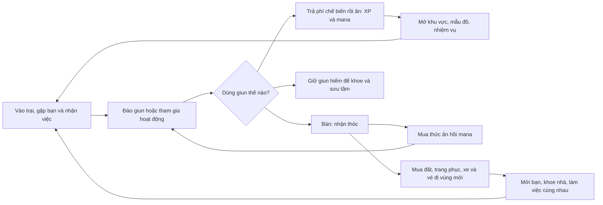
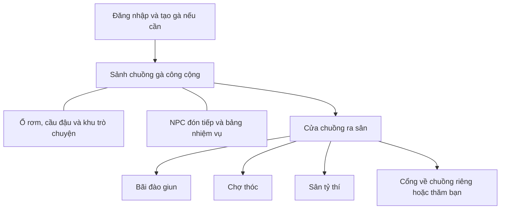
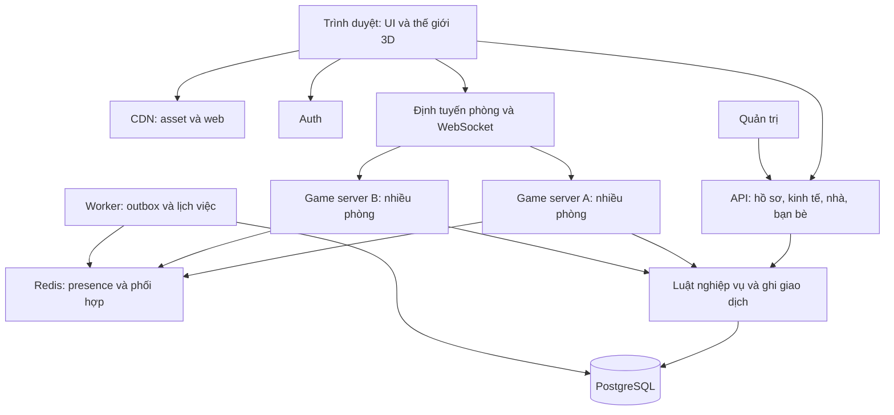

# Trang trại gà Hypex — Kế hoạch sản phẩm và triển khai

Phiên bản: 0.3 — 31/10/2026. Cập nhật: mana/no và hình phạt đói; giun nhiều độ hiếm và khoe thành tích; cửa hàng thời trang; xe cá nhân chở bạn và giao thông công cộng có lượt miễn phí. Giữ điểm bắt đầu phiên tại sảnh chuồng gà công cộng. Trạng thái: bản đề xuất để thảo luận và triển khai theo giai đoạn; chưa phải cam kết thời gian, ngân sách hoặc sức chứa đã kiểm chứng.

## 1. Định hướng và những điểm đã chốt

**Ý tưởng:** một thế giới nông trại 3D trên trình duyệt, nơi mỗi thành viên là một chú gà có cá tính, nhà riêng và nhóm bạn. Người chơi gặp nhau, đào giun, kiếm thóc, xây tổ ấm, thi đấu vui và phát triển cộng đồng.

Thông điệp sản phẩm: **“Một chú gà của riêng bạn. Một góc trại để trở về. Một hội bạn để quậy cùng.”**

Người dùng đã chọn:

- Ra mắt cho cộng đồng lớn, có nhiều phòng ngay từ đầu.
- Mỗi phòng công cộng được thiết kế thành một chuồng gà chung. Mọi người bắt đầu phiên vào game tại sảnh chuồng gà công cộng, sau bước đăng nhập và tạo nhân vật nếu là người mới.
- Thóc kiếm hoàn toàn qua hoạt động trong game; chưa có nạp tiền.
- Có thanh mana/no: hết thanh thì đói, đói quá thời gian chịu hình phạt; phải kiếm thóc để mua giun/thức ăn hồi thanh.
- Đào nhiều loại giun thường và hiếm, giun giá trị cao bán được nhiều thóc hoặc ăn để nhận nhiều XP; có thao tác khoe giun vừa đào.
- Cửa hàng có trang phục đa dạng gồm váy, vest, kính và phụ kiện. Có xe đạp, xe máy, ô tô với sức chứa khác nhau để chở bạn.
- Phương tiện công cộng đi sang trang trại/vùng khác có lượt miễn phí; dùng hết lượt phải trả thóc.
- Các ý tưởng gốc cần được giữ trong lộ trình: tạo tài khoản, thiết kế gà và giới tính, NPC động vật, chat và kết bạn, đào giun, ăn hoặc bán, lên cấp, mua đất, thuê xây dựng, PK mini-game, mời về nhà, ấp trứng ra bạn đồng hành và tạo bang phái.

Giả định thiết kế cần kiểm chứng:

| Hạng mục | Đề xuất ban đầu |
| --- | --- |
| Thiết bị | Trình duyệt máy tính và điện thoại; màn chơi ưu tiên ngang |
| Đồ họa | 3D low-poly, gà đầu lớn, thân tròn, màu sáng, hoạt ảnh hài hước |
| Góc nhìn | Camera góc nhìn thứ ba hơi cao, xoay và zoom có giới hạn |
| Phòng công cộng | Các chuồng gà chung có tên riêng; tối đa 25 người/chuồng tính cả sân liền kề; nhiều bản sao cùng bố cục |
| Nhà riêng | Phòng riêng tối đa 8 người, có quyền truy cập |
| Mốc tải công khai | Đề xuất 1.000 người online đồng thời toàn hệ thống, phải kiểm thử trước khi công bố |
| Phiên chơi | 10–20 phút vẫn có tiến triển; ở lại lâu hơn để giao lưu |
| Ngôn ngữ và thị trường đầu | Tiếng Việt, cộng đồng Hypex |
| Kinh tế | Một tiền tệ chính là thóc; giun và vật liệu là vật phẩm |

1.000 người đồng thời không có nghĩa là 1.000 người cùng xuất hiện trong một cảnh. Nếu tất cả ở phòng công cộng đầy 25 người thì cần ít nhất 40 phòng; nhà riêng, đấu trường và phòng chưa đầy làm số phòng thực tế lớn hơn. Đây là đơn vị quy hoạch, không phải suy luận về số máy chủ cần mua.

## 2. Học gì từ website tham khảo

Đã đọc HTML và JavaScript công khai của [Thiền Online](https://www.thienonline.site/). Giao diện có vùng cảnh 3D, chọn nhân vật/giới tính, chọn phòng, chat, hành động, nhiệm vụ và bảng xếp hạng. Nội dung của trang cho biết lựa chọn và tiến độ cá nhân được lưu trên thiết bị. Việc tham khảo này chưa bao gồm kiểm thử tương tác trực tiếp, chất lượng hình ảnh hay khả năng chịu tải của trang.

Áp dụng cho Hypex: cảnh 3D chiếm phần lớn màn hình; các tác vụ mở bằng bảng nhỏ; vào thế giới nhanh; điều khiển đơn giản. Tài khoản, tài sản và tiến độ Hypex được lưu tập trung trên máy chủ. Phong cách nghệ thuật, nhân vật, bản đồ và nội dung sẽ được thiết kế riêng.

## 3. Ba trụ cột và vòng chơi

1. **Thể hiện bản thân:** gà, trang phục, tên, biểu cảm, danh hiệu, tổ ấm.
2. **Tiến triển và sinh hoạt:** săn giun → bán kiếm thóc hoặc chế biến để ăn lấy XP → mua thức ăn duy trì mana → dành dụm cho thời trang, nhà và xe.
3. **Có lý do gặp nhau:** chat, mini-game, thăm nhà, làm việc thuê, sự kiện và Hội Gà.

Theo yêu cầu cập nhật, đói là cơ chế có hình phạt thực sự. Đề xuất phạt tạm thời lên di chuyển và khả năng làm hoạt động, hồi phục bằng ăn uống; không trừ cấp hoặc thu hồi nhà đã mua. Chi tiết thời gian, mức phạt và cách kiếm bữa ăn khi hết thóc ở mục 7.4 là thông số đề xuất để thử, chưa phải lựa chọn đã được người dùng chốt.

## 4. Trải nghiệm 15 phút đầu

| Thời điểm mục tiêu | Trải nghiệm | Kết quả |
| --- | --- | --- |
| Phút 0–2 | Đăng ký/đăng nhập, tạo tên, chọn gà và giới tính rồi xuất hiện trong sảnh chuồng gà công cộng | Có tài khoản, avatar được lưu và thấy người chơi cùng chuồng |
| Phút 2–4 | Gà trưởng trại đón tại sảnh, hướng dẫn đi lại, camera, tương tác | Đi tới NPC và hoàn thành thao tác đầu ngay trong chuồng |
| Phút 4–7 | Lợn Ủn dẫn đến bãi giun dành cho người mới | Nhặt được giun đầu tiên |
| Phút 7–9 | Bán giun, dùng thóc mua thức ăn; thử chế biến một giun khác để ăn | Hiểu thóc, mana và XP; phần thưởng hướng dẫn đủ trả món ăn/phí chế biến |
| Phút 9–12 | Bò Mộc tặng tổ nhỏ, chỉ cách đặt vật trang trí | Sở hữu và trang trí không gian đầu tiên |
| Phút 12–15 | Chào người khác, thử PK hoặc mời bạn | Có tương tác xã hội đầu tiên |

Các mốc phút là mục tiêu thử nghiệm với người mới. Nhiệm vụ xã hội có lựa chọn thay thế nếu chưa có người trực tuyến. Có thể bỏ qua hướng dẫn và mở lại; phần thưởng chỉ nhận một lần trên tài khoản. Tiến trình lưu sau từng bước, thoát giữa chừng vẫn tiếp tục được.

Luồng vào game: đăng nhập → tạo gà nếu chưa có → vào sảnh chuồng gà công cộng → trò chuyện, nhận hướng dẫn hoặc ra sân chơi. Người đã có chuồng riêng vẫn bắt đầu phiên mới ở sảnh chung, rồi chủ động chọn về nhà. Khi tiếp tục hướng dẫn dở, nhiệm vụ được giữ nhưng nhân vật xuất hiện tại sảnh chung.

## 5. Nhân vật gà và cá tính

- Một tài khoản có một nhân vật chính ở bản đầu.
- Tùy chỉnh màu lông, mào, mỏ, mắt, đuôi, mũ, kính, phụ kiện cổ và áo phù hợp bộ khung gà.
- Giới tính hồ sơ: nam, nữ, khác hoặc không hiển thị. Kiểu dáng gà trống/gà mái là lựa chọn ngoại hình độc lập; không quyết định chỉ số hoặc quyền dùng trang phục.
- Xem trước gà 3D, xoay và đổi màu trước khi lưu; đổi lại lựa chọn hồ sơ trong cài đặt.
- Tên hiển thị có kiểm duyệt; mã người chơi duy nhất phục vụ tìm bạn khi trùng tên.
- Biểu cảm đầu: chào, vui, buồn, ngạc nhiên, múa, gáy, ăn mừng.
- Trạng thái hoạt ảnh: đứng, đi, chạy, đào, ăn, ngồi, ngủ, biểu cảm, thắng, ngã KO và đứng dậy.
- Mặc đồ chỉ đổi hình thức ở bản đầu. Cấp không làm người chơi thắng PK dễ hơn.

Gói mỹ thuật đề xuất cho bản công khai: 1 bộ khung gà dùng chung, 6 màu lông, 3 mào, 3 đuôi, 6 kiểu mắt và khoảng 24 món thời trang, có váy, vest, áo, mũ, kính và phụ kiện. Phối đồ và giới hạn tương thích được mô tả ở mục 8.3. Số lượng cuối phụ thuộc kiểm thử hiệu năng và chất lượng asset.

## 6. Thế giới, phòng và NPC

### 6.1. Các khu vực

| Khu | Vai trò | Phiên bản |
| --- | --- | --- |
| Sảnh chuồng gà công cộng Hypex | Điểm xuất hiện khi vào game, gặp bạn, NPC đón tiếp, bảng tin và sinh hoạt chung | V1 |
| Chợ thóc | Bán giun, mua đồ, nhận việc từ NPC | V1 |
| Vườn giun | Khu đào cơ bản; thêm vùng tốt hơn khi lên cấp | V1 |
| Sân tỷ thí | Mời PK và xem trận trong giới hạn phòng | V1 |
| Cổng khu dân cư | Đến nhà mình/bạn bè, xem danh sách nhà mở cửa | V1 |
| Trạm ấp trứng | Nhận và ấp bạn đồng hành | V1.1 |
| Nhà Hội Gà | Hoạt động bang và công trình chung | V1.2 |
| Ao, vườn cây, khu hội chợ | Câu cá, trồng trọt, lễ hội luân phiên | Mở rộng |
| Quầy thời trang và quầy thức ăn | Thử/mua đồ, mua giun thức ăn và món hồi mana; đặt tại chợ | V1 |
| Bến xe Chim Chíp | Xem tuyến, lượt miễn phí, mua vé sang vùng khác | V1.1 |
| Trang trại Ven Suối | Điểm đến khác với trại Hypex ban đầu, có bãi giun đặc sản và bến về | V1.1 |
| Cửa hàng xe và điểm đỗ | Mua xe, lấy/cất xe, lên/xuống cùng bạn | V1.1–V1.2 |

V1 lấy một chuồng gà công cộng lớn làm trung tâm bản đồ. Bên trong là sảnh sinh hoạt chung; cửa chuồng mở ra sân có đường tới chợ, vườn giun, sân tỷ thí và cổng về chuồng riêng. Sảnh và sân liền kề thuộc cùng một phòng công cộng, dùng chung giới hạn 25 người để tránh chuyển cảnh liên tục. Nhà riêng và trận đấu là các phòng riêng khi cần.

### 6.2. Dàn NPC

| NPC | Tính cách | Nhiệm vụ |
| --- | --- | --- |
| Gà Cụ Cục | Hơi lắm lời, tốt bụng | Hướng dẫn, nhiệm vụ chính, giải thích thế giới |
| Lợn Ủn | Vui tính, mê đào bới | Dạy đào giun, mua giun, giao đơn hằng ngày |
| Bò Mộc | Điềm đạm, giỏi nghề | Bán mẫu nhà, xây dựng, nâng cấp đất |
| Chó Mực | Năng động, công bằng | Hướng dẫn PK, trọng tài mini-game |
| Chim Chíp | Nói nhanh, thân thiện | Thư, tin sự kiện, hướng dẫn kết bạn; hướng dẫn bến xe ở V1.1 |
| Vịt Bông | Chăm sóc chu đáo | Ấp trứng và chăm bạn đồng hành ở V1.1 |

NPC đầu tiên dùng hội thoại kịch bản và lựa chọn rõ ràng. Chưa cần AI hội thoại. NPC không tự quyết phần thưởng; mọi phần thưởng dựa trên luật máy chủ.

### 6.3. Quy tắc nhiều phòng

- Tự tìm chuồng công cộng có chỗ khi vào game, đặt nhân vật tại điểm xuất hiện an toàn trong sảnh. Ưu tiên chuồng có bạn bè nếu quyền riêng tư cho phép và còn chỗ; sau đó ưu tiên chuồng đang có người để sảnh có sinh hoạt, rồi mới mở chuồng mới.
- Hiển thị tên và sức chứa như “Chuồng Hạt Thóc · 01 — 18/25”. Trong UI dùng “Đổi chuồng”, “Mời vào chuồng” và “Chat chuồng”; thuật ngữ phòng/room giữ trong tài liệu kỹ thuật. Mã chuồng giúp phân biệt các bản sao có cùng chủ đề.
- Tất cả chuồng công cộng đều có sảnh khởi đầu và các tiện ích tương đương. Người chơi mới và cũ có thể gặp nhau; không gom toàn bộ cộng đồng vào một cảnh vượt giới hạn.
- Bạn bè và lời mời hoạt động xuyên phòng. Đến phòng bạn cần còn chỗ và được phép; có hàng đợi khi đầy.
- Nhóm tối đa 4 người có thể yêu cầu vào cùng một phòng; giữ chỗ bằng vé có thời hạn.
- Đổi phòng không reset nhiệm vụ, giới hạn đào, hồi chiêu hoặc phần thưởng.
- Khi chuyển phòng, máy chủ đích nhận vé một lần; phiên cũ mất quyền hành động trước khi phiên mới hoạt động.
- Một tài khoản chỉ có một phiên chơi đang điều khiển nhân vật. Đăng nhập nơi khác cần luồng chuyển phiên rõ ràng.
- Không dồn người dùng về một phòng sự kiện duy nhất. Chạy nhiều bản sao; cộng tiến độ sự kiện ở cấp toàn cộng đồng.
- Mỗi lần bắt đầu phiên chơi mới đều vào sảnh chung; không tự xuất hiện ở chuồng riêng, bãi đào hay đấu trường theo vị trí đã lưu. Link mời về nhà được giữ để người chơi xác nhận đi tiếp sau khi vào sảnh.
- Nối lại kết nối của phiên còn hiệu lực là tiếp tục phiên cũ: giữ vị trí/trạng thái theo luật reconnect, nhất là trận PK. Nếu phiên hết hạn hoặc không phục hồi được thì quay về sảnh chung; không dùng thao tác tải lại trang để xóa trạng thái trận đang diễn ra.

### 6.4. Thiết kế sảnh chuồng gà công cộng

Sảnh là một chuồng gà rộng, ấm cúng và hoạt hình: khung gỗ, mái ngói hoặc mái rơm, ổ rơm ven tường, cầu đậu thấp, bao thóc, máng ăn, máng nước, cửa sổ đón nắng và bảng hiệu Hypex. Kích thước được cách điệu để 25 chú gà đi lại thoải mái và dễ nhìn thấy nhau.

| Vị trí | Bố trí và tương tác |
| --- | --- |
| Cửa vào và thảm rơm đón khách | Nhiều điểm xuất hiện rải nhẹ để gà mới vào không chồng lên nhau; Gà Cụ Cục đứng gần đó |
| Khoảng sàn giữa chuồng | Đi lại, chat, biểu cảm, làm quen và mời PK; trận PK bắt đầu ở khu/phòng phù hợp sau xác nhận |
| Dãy ổ rơm và cầu đậu hai bên | Ngồi, nghỉ, tụ tập theo nhóm; là tiện ích chung, không phải nhà sở hữu cá nhân |
| Góc bảng tin | Nhiệm vụ, sự kiện, hướng dẫn, số người và chuyển chuồng |
| Góc máng ăn và bao thóc | Tạo chất nông trại, biểu diễn hoạt ảnh ăn; hồi mana/XP cần thức ăn đã mua hoặc giao dịch chế biến giun có trả thóc theo mục 7 |
| Cửa lớn phía sân | Ra sân để tới bãi giun, chợ và sân tỷ thí; có biển chỉ đường bằng biểu tượng |
| Bảng chỉ đường về chuồng riêng | Mở lựa chọn về nhà, thăm bạn hoặc xem chuồng mở cửa |

Camera nhìn chéo từ trên; mái và tường phía gần camera tự ẩn hoặc mờ khi che nhân vật. Hạn chế vách cao giữa sảnh, giữ lối đi rõ, không cho avatar chặn cửa hoặc cản người khác ở điểm xuất hiện. Người chơi không được di chuyển nội thất công cộng; thay đổi trang trí sảnh do hệ thống/sự kiện quản lý.

Tên chủ đề đề xuất: Chuồng Hạt Thóc, Chuồng Rơm Vàng, Chuồng Bình Minh. Bản đầu dùng chung bố cục và luật, có thể khác màu biển hiệu; không tạo lợi thế tài nguyên theo tên chuồng.

## 7. Đào giun, ăn và lên cấp

### 7.1. Luật đào

Đi tới điểm đất trong phạm vi cho phép → bấm tương tác → hoàn thành mini-game canh nhịp ngắn → máy chủ chốt kết quả → giun vào túi. Không yêu cầu spam chạm liên tục để đào.

- V1 có 5 loại giun từ thường đến huyền thoại, với bảng xác suất và giá rõ ràng ở mục 7.2. Nhiều màu/hiệu ứng không đồng nghĩa phải tạo 5 bộ khung hoạt ảnh khác nhau.
- Tài nguyên cơ bản có lượt thu hoạch theo người chơi để người mới không bị người khác lấy hết. Hiệu ứng đào vẫn thấy được trong phòng.
- Hồi chiêu theo tài khoản và nhóm bãi đào, không theo mã phòng.
- Giới hạn khởi điểm: tối đa 1 phần thưởng mỗi 45 giây và 120 lượt có thưởng/ngày, cộng thêm kiểm tra thời gian hoàn thành thao tác. Đây là cấu hình thử nghiệm, không phải cân bằng cuối.
- Không coi mini-game là cách chống bot tuyệt đối. Máy chủ kiểm tra tốc độ, khoảng cách, trạng thái và mẫu hành vi bất thường.
- Túi đầy: báo rõ, không âm thầm xóa vật phẩm. Phần thưởng chưa nhận đi vào hàng chờ có giới hạn hoặc dừng lượt trước khi bắt đầu.

### 7.2. Giun thường, giun hiếm và lựa chọn sử dụng

| Giun tự đào | Độ hiếm | Tỷ lệ thử ở bãi cơ bản | Bán NPC | XP khi ăn | Mana hồi | Phí chế biến |
| --- | --- | --- | --- | --- | --- | --- |
| Giun đất | Thường | 75% | 5 thóc | 10 | 10 | 2 thóc |
| Giun béo | Khá hiếm | 20% | 12 thóc | 25 | 20 | 3 thóc |
| Giun phát sáng | Hiếm | 4% | 40 thóc | 80 | 30 | 5 thóc |
| Giun vàng | Sử thi | 0,9% | 150 thóc | 200 | 40 | 8 thóc |
| Giun cầu vồng | Huyền thoại | 0,1% | 500 thóc | 500 | 60 | 12 thóc |

Tổng xác suất 100%, một con mỗi lượt đào có thưởng thành công. Đây là bảng cân bằng thử nghiệm. Độ hiếm quyết định giá/XP; kích thước và kỷ lục ban đầu chỉ để sưu tầm, không nhân tiếp phần thưởng. XP cao giúp lên cấp nhanh hơn nhưng không cộng cấp trực tiếp hoặc tăng khả năng thắng PK.

Để giữ yêu cầu phải dùng thóc cho sinh hoạt, đề xuất giun tự đào có ba cách dùng: bán; giữ trưng bày; hoặc trả phí chế biến rồi ăn để nhận XP và mana. Có nút “Chế biến & ăn” thực hiện nguyên tử trong một giao dịch: trừ đúng một con và phí, cộng XP/mana. Nếu không đủ thóc hoặc mana đã đầy thì không thực hiện, không mất giun. Có thể ăn tại chỗ bằng túi đồ để không phải chạy về NPC mỗi lần; phí được hiển thị rõ trước khi xác nhận.

Giun thức ăn mua ở cửa hàng là loại vật phẩm riêng: hồi mana, không nhận XP, không bán lại hoặc chuyển nhượng. Các món ăn mua khác cũng không cấp XP ở V1. Nhờ vậy không thể mua giun rẻ rồi bán như giun hoang hiếm hoặc mua XP không giới hạn. Cùng một con giun tự đào chỉ được bán hoặc ăn một lần; ghi nhận trong sổ sưu tầm không tạo bản sao có thể bán.

### 7.2.1. Làm hoạt động đào có chiều sâu

- Chuỗi thao tác ngắn: quan sát dấu đất → chọn vị trí → canh lực đào → kéo giun bằng giữ/thả trong vùng ổn định. Hiệu ứng đất rung và giun ló đầu tạo chờ đợi trước khi hiện kết quả.
- Đào cơ bản dễ để người mới luôn có đường kiếm ăn. Độ chính xác mở thành tích và tăng tốc thao tác trong giới hạn, chưa tăng xác suất hiếm ở V1 để tránh bot thao tác hoàn hảo thống trị kinh tế.
- V1 có các tiểu vùng đất vườn/đất ẩm/gốc cây với hình thức khác nhau và cùng bảng cơ bản. V1.1 mở vùng đặc sản, bộ giun theo vùng và bảng xác suất riêng có hiển thị; phải mô phỏng lại thu nhập sau tiền vé.
- Thử thách sưu tầm theo ngày/tuần: đào đủ loài, tìm kỷ lục chiều dài, hoàn thành yêu cầu của Lợn Ủn. Phần thưởng chỉ nhận một lần theo mốc, không tạo chuỗi thưởng tự lặp.
- Không tăng độ hiếm bằng cách đổi chuồng hoặc tải lại trang. Xác suất và vật phẩm do máy chủ quyết định, không lấy kết quả client gửi lên.
- Theo dõi chuỗi không có giun hiếm trong beta trước khi thêm cơ chế bảo đảm. V1 không hứa “đào đủ lượt chắc chắn ra” khi chưa có luật và bảng xác suất tương ứng.

### 7.2.2. Khoe giun vừa đào

- Mọi kết quả đều có thẻ chiến lợi phẩm; giun hiếm trở lên có hoạt ảnh gà nâng giun, ánh sáng theo độ hiếm, tên loài, kích thước và nút “Khoe với chuồng”.
- Khi bấm khoe, người gần đó thấy gà nâng giun và chat chuồng nhận thẻ có thể xem; không tự bật cửa sổ che màn hình người khác.
- Thẻ lấy dữ liệu từ bản ghi lần đào trên máy chủ: người đào, loài, kích thước, thời gian, khu vực và ID lần đào. Không chấp nhận thẻ tự dựng bởi client.
- Mỗi lần đào chỉ chia sẻ một lần; mỗi người tối đa một thẻ/60 giây, có thể ẩn thông báo khoe. Chưa broadcast toàn hệ thống để giữ chat dễ đọc.
- Sổ giun giữ thành tích “đã từng đào”, kể cả đã ăn/bán. Trưng bày giun sống trong chuồng riêng yêu cầu còn sở hữu đúng cá thể; tháo khỏi hộp trước khi bán/ăn.
- Giun hiếm có ID cá thể; giun thường có thể xếp chồng. Bản ghi chiến lợi phẩm và vật phẩm sở hữu là hai đối tượng khác nhau để tránh nhân đôi tài sản.

### 7.3. Tiến triển

- Cấp 1: khu công cộng, chat, đào giun, tổ nhỏ miễn phí.
- Cấp 3: mở mua đất nâng cấp và thêm mẫu trang trí.
- Cấp 5: mở hệ thống ấp trứng khi V1.1 phát hành.
- Cấp 7: mở nghề và hợp đồng xây dựng ở V1.1.
- Cấp 10: được lập Hội Gà khi V1.2 phát hành; tham gia hội từ sớm hơn.
- Trần cấp thử nghiệm V1: 10. Tính năng chưa phát hành được ghi rõ; không quảng cáo như phần thưởng đã dùng được.

Công thức khởi điểm: XP để đi từ cấp L lên L+1 = 80 + 40 × (L−1). Tổng từ cấp 1 lên 10 là 2.160 XP. Một giun cầu vồng có thể cho 500 XP nên tốc độ tiến triển có biến động lớn; phải mô phỏng phân bố cấp theo ngày cùng XP nhiệm vụ và khả năng trả phí chế biến. Không đưa phần thưởng tương lai vào lời hứa với người chơi trước khi có lịch phát hành.

### 7.4. Thanh mana/no, đói và hình phạt

Trong sản phẩm dùng nhãn **“Mana · Độ no”**, một thanh duy nhất từ 0–100. Mục đích là sức ăn/sinh hoạt của gà, chưa thêm một thanh năng lượng thứ hai gây khó hiểu.

Quy tắc thử nghiệm: giảm 1 điểm/phút khi phiên online còn hoạt động và thêm 1 điểm cho mỗi lượt đào có thưởng hoàn thành. Không trừ thêm vì chat, PK hoặc đi xe ở bản đầu. Người mới bắt đầu 100; sau đó đăng nhập, lên cấp, đổi chuồng hoặc qua ngày không tự hồi. Chỉ mua và ăn thức ăn, hoặc trả phí chế biến giun, mới hồi thanh.

| Trạng thái | Điều kiện đề xuất | Hệ quả |
| --- | --- | --- |
| Bình thường | Mana ≥20 | Hoạt động bình thường |
| Sắp đói | Mana từ 1 đến dưới 20, chưa có phạt lưu lại | Thanh chuyển màu, gà có biểu cảm đói, gợi ý mở túi/cửa hàng |
| Đói | Mana =0, chưa tích đủ 5 phút online tại 0 kể từ lần hồi đạt 20 gần nhất | Cảnh báo và đếm ngược đến hình phạt; vẫn kiếm ăn được |
| Đói kéo dài | 5 đến dưới 10 phút online tại 0 | Đi bộ chậm 15%, thao tác đào kéo dài 25% |
| Kiệt sức | Từ 10 phút online tại 0 | Giữ giảm tốc, dừng đào có thưởng, không nhận PK mới hoặc lái xe; vẫn chat, mua/ăn, đi xe làm khách và làm việc cứu đói |

Các mốc là phương án đề xuất, có thể đổi sau playtest. Không trừ XP/thóc tự động hay tạo nợ tăng dần. Ăn đưa mana lên ít nhất 20 thì gỡ phạt và reset bộ đếm đói; hồi dưới 20 thì giữ mức phạt đã có cho đến khi đạt ngưỡng này, nhưng bộ đếm chỉ tăng khi mana bằng 0. Trạng thái và thời gian do máy chủ tính, dùng cùng nguồn dữ liệu xuyên phòng.

Đề xuất chỉ tăng đói/phạt trong thời gian online, không cộng dồn lúc offline. Phiên mất liên lạc quá 30 giây sẽ ngừng tính; phần thời gian online đã tích lũy và mức phạt vẫn được lưu. Tab nền còn kết nối vẫn tính và được cảnh báo; không tin client tự khai “đang offline”. Thoát game không hồi mana hay xóa hình phạt.

Ăn hồi tối đa 100, phần dư mất và được báo trước; không cho ăn khi đã đầy. Phí chế biến, giun/thức ăn, XP và mana cùng commit một lần. Khi vào PK, chốt điều kiện đủ sức ở đầu trận và áp dụng hạn chế mới sau trận để không đổi luật giữa lúc thi đấu. Nếu kiệt sức khi đang lái xe, hệ thống giảm tốc và dừng an toàn; chủ xe cần ăn hồi đủ sức để lái tiếp hoặc cho mọi người xuống an toàn, không văng hành khách.

**Đường phục hồi khi hết thóc:** NPC Cụ Cục có việc “Dọn ổ rơm”, mất khoảng 60 giây thao tác và trả 5 thóc — đủ mua một khẩu phần +20 mana. Chỉ mở khi mana ≤20, ví <5 và không có thức ăn/giun có thể dùng hoặc bán; không bị giới hạn 120 lượt đào/ngày, không cần vé đi lại. Mỗi tài khoản chỉ có một việc đang làm và một lần nhận thưởng cho mỗi job ID. Nếu kẹt ở vùng xa, dùng “Về sảnh chuồng” miễn phí để gặp NPC. Cách này vẫn buộc người chơi làm việc kiếm thóc mua ăn, đồng thời tránh vòng kẹt không thể chơi tiếp.

## 8. Kinh tế bằng thóc

### 8.1. Thóc đi vào và ra khỏi hệ thống

| Loại | Nguồn hoặc nơi dùng |
| --- | --- |
| Tạo thóc | Bán giun cho NPC, nhiệm vụ có hạn mức, sự kiện có ngân sách thưởng |
| Chuyển thóc giữa người chơi | Tiền công xây dựng, giao dịch V1.1; không tính là tạo tiền mới |
| Tiêu hủy thóc | Mua thức ăn, chế biến giun, mua đất/trang phục/đồ trang trí/xe, vé đi lại, thuê NPC, phí dịch vụ |
| Không có ở V1 | Nạp tiền, đổi thóc ra tiền thật, vay, gửi lấy lãi, đặt cược PK |

Thức ăn là chi phí sinh hoạt bắt buộc để tránh hình phạt đói. Nhà đã mua không bị thu hồi vì thiếu phí duy trì. Sau khoản ăn uống, người chơi dành thóc cho trang trí, đất, xe và các chuyến khám phá.

### 8.2. Bảng giá khởi điểm để thử

| Hạng mục | Giá đề xuất |
| --- | --- |
| Thưởng hoàn thành hướng dẫn, một lần | 100 thóc |
| Tổ nhỏ ban đầu + một đồ trang trí | Miễn phí, không bán/chuyển nhượng |
| Tổng thưởng 3 nhiệm vụ ngày | 60 thóc |
| Khẩu phần cám hoặc giun thức ăn nuôi | 5 thóc, +20 mana, 0 XP |
| Đĩa rau trộn | 12 thóc, +50 mana, 0 XP |
| Suất ăn đầy đủ | 20 thóc, +100 mana, 0 XP |
| Đồ trang trí phổ thông | 80–200 thóc |
| Phụ kiện cơ bản | 200–400 thóc |
| Váy/vest theo bộ | 500–1.200 thóc tùy mẫu, chỉ đổi ngoại hình |
| Nâng tổ lên mảnh đất riêng đầu tiên | 1.200 thóc |
| Thuê Bò Mộc xây chuồng theo mẫu cơ bản | 500 thóc; tổng giá hiển thị trước |
| Mở rộng đất lần đầu | 3.000 thóc |
| Xe đạp có ghế sau / xe máy / ô tô | 800 / 3.000 / 10.000 thóc; mở theo giai đoạn |
| Vé công cộng sau khi hết lượt miễn phí | 10 thóc tuyến gần, 25 thóc tuyến xa; mở theo giai đoạn |

Mô phỏng sơ bộ theo bảng mới: 20 lượt đào thành công có kỳ vọng 192 thóc nếu bán hết, hoặc 360 XP nếu chế biến và ăn toàn bộ, khi đủ tiền phí và khả năng tiêu thụ. Các kết quả hiếm làm trung bình cao hơn trải nghiệm của nhiều phiên ngắn; đây không phải khoản thu bảo đảm.

Ví dụ phiên 20 phút có 20 lượt đào: giảm khoảng 40 mana (20 theo thời gian +20 đào). Nếu bán toàn bộ và dành 12 thóc mua đĩa rau, cộng 60 thóc nhiệm vụ ngày thì khoản để dành kỳ vọng là 192+60−12 = 240 thóc/ngày, chưa tính vé và chi tiêu khác. Với 100 thóc khởi đầu, mục tiêu đất 1.200 thóc khoảng 5 ngày theo kỳ vọng này. Kịch bản cả 20 con đều thường chỉ để dành 100+60−12 = 148 thóc/ngày, mất khoảng 8 ngày. Lượng mana hồi dư không tích quá 100 và người chơi không bắt buộc mua đúng món trong ví dụ.

Phải mô phỏng thêm người ở lâu chỉ chat, người cày 120 lượt/ngày, người giữ giun hiếm, chi phí chế biến và tiền vé. Không cân bằng giá sinh hoạt dựa trên giả định ai cũng may mắn đào được giun vàng/cầu vồng. Mục tiêu thử: một lượng nhỏ giun thường hoặc một việc cứu đói luôn đủ mua bữa cơ bản, phần thu còn lại đủ thấy tiến triển về nhà/xe.

Giới hạn 120 lượt/ngày vẫn cho phép người cày nhiều tiến nhanh hơn; phải kiểm tra chênh lệch người chơi nhẹ và người cày, thời gian lên cấp, lượng thóc tồn và tốc độ mua đất. Có thể chỉnh giới hạn và giá sau playtest; mọi thay đổi cần thông báo và ghi phiên bản cấu hình.

V1 chưa chuyển thóc trực tiếp giữa người chơi. V1.1 mở giao dịch có xác nhận hai bên và hợp đồng lao động. Các cơ chế này thuộc lộ trình gốc, được đưa sau để kiểm soát việc nhân đôi tài sản và chuyển phần thưởng tài khoản mới.

### 8.3. Cửa hàng thời trang và tủ đồ

- Danh mục ban đầu: váy, vest, áo thường, mũ, kính, nơ/khăn cổ và phụ kiện lưng. Chủ đề gồm nông dân, dạ hội, lịch lãm và vui nhộn.
- Cửa hàng có bộ lọc loại/giá/màu, xem gà 3D xoay 360 độ, thử nhiều món và xem tổng thóc trước khi mua. Có nhãn đã sở hữu, không mua trùng món vĩnh viễn.
- Các slot: đầu, mắt, cổ, thân, lưng. Váy và vest chiếm slot thân nên thay thế nhau ở V1; bộ đặc biệt khai báo rõ slot bị chiếm. Mũ và kính có thể phối cùng nếu không xung đột.
- Trang phục không khóa theo giới tính hồ sơ. Chọn mẫu phù hợp dáng gà và kiểm tra khi đi, đào, ngồi, KO và ngồi xe.
- Tủ đồ cho lưu 3 bộ phối sẵn, đổi ngoài trận PK; chỉ trang bị vật phẩm đã sở hữu. Bỏ xem trước trả lại bộ đang mặc, không ghi nhầm vào nhân vật thật.
- V1 mua bằng thóc, không nhận chỉ số sức mạnh/đào hiếm từ đồ mặc. Chưa bán lại/chuyển nhượng trang phục; không có vòng hoàn tiền bằng cách mua, mặc rồi trả lại tùy ý.
- Bộ sưu tập theo mùa và danh hiệu giúp tạo mục tiêu dài hạn; lịch bán và giá hiển thị rõ, không bắt buộc quay thưởng để mua bộ quần áo đã chọn.

### 8.4. Phương tiện cá nhân và chở bạn

| Phương tiện đề xuất | Tổng ghế, gồm người lái | Chở thêm | Công dụng |
| --- | --- | --- | --- |
| Xe đạp có ghế sau | 2 | 1 người | Di chuyển trong sân/đường trại, chuyến đi ngắn |
| Xe máy | 2 | 1 người | Đi đường liên trại nhanh hơn |
| Ô tô nhỏ | 4 | 3 người | Đi chơi theo nhóm |
| Xe buýt công cộng | 8 hành khách, tài xế NPC riêng | Theo ghế được giữ | Chuyến theo tuyến, không cần sở hữu xe |

Giá thử ở bảng 8.2; tốc độ khởi điểm xe đạp/xe máy/ô tô khoảng 1,3/1,7/2 lần tốc độ chạy bộ, có giới hạn thấp hơn gần bến và nơi đông người. V1.1 triển khai xe đạp và xe công cộng; V1.2 thêm xe máy, ô tô sau khi cơ chế ghế/chuyển vùng ổn định. Tất cả đều nằm trong phạm vi sản phẩm, thứ tự này là đề xuất triển khai.

- Mua xe qua cửa hàng, sở hữu được lưu lâu dài; lấy/cất tại điểm đỗ ngoài chuồng. Mỗi người tối đa một xe đang xuất hiện.
- Chỉ chủ xe lái trong lần phát hành đầu. Mời một người lên xe hoặc mở ghế cho bạn bè; hành khách phải chấp nhận, có thể tự xuống ở vị trí an toàn.
- Sức chứa là ràng buộc máy chủ: hai yêu cầu tranh ghế cuối chỉ một người được nhận. Khóa ghế theo chuyến, không đặt chồng avatar lên nhau.
- Đi chung xe là tương tác bạn bè, chưa thu thóc tự động giữa chủ xe và hành khách. Xe không gây sát thương, không húc đẩy người hoặc chặn cửa; tránh dùng vật lý va chạm xe phức tạp ở bản đầu.
- Không lái trong sảnh chuồng công cộng, bên trong nhà, khu đào và trận PK. Có điểm đỗ cạnh cửa/bến; giữ xe không chiếm slot người chơi nhưng phải nằm trong ngân sách render.
- Khi đi sang vùng khác, chọn vùng ở cổng đường; hệ thống giữ đủ chỗ cho cả nhóm trước khi chuyển. Nếu thiếu chỗ thì cùng chờ/chọn bản sao khác, không tự tách hành khách sang phòng khác.
- Mỗi người phải đủ điều kiện vào vùng; chủ xe không chở người chưa mở vùng vượt khóa cấp. Xe không cho đào giun, bán đồ tại NPC xa hoặc tham gia PK từ trên xe.
- Mất kết nối người lái: xe dừng an toàn, chờ tối đa 15 giây; hết thời gian trả khách xuống điểm an toàn. Hành khách mất kết nối giữ ghế 15 giây rồi giải phóng; nối lại muộn xuất hiện ở điểm xuống an toàn. Không tự chuyển quyền lái.
- Không hủy xe khi đang có khách mà chưa trả khách về điểm an toàn. Bị chủ xe chặn/kick cũng xuống an toàn, không mất hành lý hoặc tài sản.
- Phiên bản đầu không thêm xăng, hư hỏng hoặc phí bảo hiểm; ưu tiên hoàn thiện lái/chở và ngân sách thức ăn. Xe riêng không mất vé công cộng.

### 8.5. Phương tiện công cộng, lượt miễn phí và vùng mới

**Chuồng công cộng** là một bản sao/kênh của cùng nơi; **trang trại/vùng** là điểm đến có bản đồ và nội dung khác. “Đổi chuồng” trong cùng vùng, mời bạn vào cùng bản sao và thăm chuồng riêng trong vùng không tốn vé. Phí giao thông áp dụng cho chuyến sang vùng khác, không áp cho việc phân tải máy chủ.

- Đề xuất 3 chuyến công cộng miễn phí/ngày/tài khoản, một lượt là một chiều cho một người, reset lúc 00:00 Asia/Ho_Chi_Minh. Không cộng dồn, không bán/chuyển lượt; đổi chuồng hay thiết bị không reset.
- Khi còn lượt miễn phí, ưu tiên dùng lượt. Hết lượt thì hiện giá tuyến và yêu cầu xác nhận trả thóc. Các tuyến gần/xa đề xuất 10/25 thóc; mỗi hành khách thanh toán hoặc dùng lượt của chính mình.
- Bảng bến hiển thị đích đến, điều kiện cấp, thời gian chờ tối đa đề xuất 30 giây, ghế trống, lượt còn lại và phí. Chuyến vẫn chạy khi không đủ 8 khách; không buộc chờ đầy xe.
- Luồng: chọn tuyến → giữ ghế/lượt hoặc thóc → xác nhận → máy chủ đích nhận chỗ → hoàn tất chuyến và quyết toán. Không có ghế thì không trừ tiền/lượt.
- Hủy trước khởi hành hoặc lỗi hệ thống chưa bàn giao thành công: trả đúng khoản thóc/lượt đã giữ một lần. Đã đến đích mà mất mạng trước màn thông báo thì đọc lại trạng thái chuyến, không tự hoàn tiền.
- Mỗi chuyến có trip ID và mỗi vé có booking ID. Khi chuyển phòng dùng vé đích một lần; chốt việc trừ lượt/thóc theo kết quả lưu bền vững, job đối soát phục hồi chuyến dở sau lỗi máy chủ.
- Vé miễn phí giữ qua mốc ngày thuộc quota ngày đặt vé; hủy sau nửa đêm trả vào quota ngày cũ, không biến thành lượt cộng thêm của ngày mới. Vé mới dùng quota ngày hiện tại.
- Có nút “Về sảnh chuồng Hypex” miễn phí, ngắt việc đang làm theo đúng luật và chỉ dùng khi không ở trận/chuyển vùng. Đây là lối hồi về trại gốc, cũng phù hợp với quy tắc phiên đăng nhập mới về sảnh; không đưa miễn phí tới các vùng kiếm tài nguyên khác. Chi phí vé tập trung ở chuyến đi ra vùng mới hoặc giữa các vùng.
- Giai đoạn đầu chuyển vùng qua đoạn xe chạy/hiệu ứng ngắn rồi tải bản đồ đích; không hứa toàn thế giới liền mạch. Mọi tài sản, mana và hạn mức hoạt động đi theo tài khoản.
- V1.1 cần ít nhất hai vùng thật: trại Hypex và trại Ven Suối, bến hai đầu, nhiệm vụ và nội dung giun đặc sản. Không bán vé cho điểm đến chưa có gameplay.

## 9. Đất, nhà và thuê xây dựng

### 9.1. Nhà riêng ở V1

- Mỗi người có một tổ khởi đầu. Mua đất là nâng cấp quyền sở hữu hiện có, không tranh lô có hạn với người chơi khác.
- Nhà riêng cũng được thể hiện thành chuồng gà, bắt đầu bằng chuồng nhỏ có ổ rơm rồi mở rộng chuồng và sân. Nhà nằm trong phòng riêng được tạo khi có người vào, lưu bố cục lâu dài.
- Sở hữu chuồng riêng không đổi điểm bắt đầu phiên: người chơi vẫn vào sảnh chuồng công cộng trước, rồi chọn “Về chuồng của tôi”. Các ổ rơm tại sảnh chung không được coi là nhà riêng.
- Đặt đồ theo lưới, xoay 90 độ, xem trước vị trí hợp lệ; không cho chặn lối vào.
- Giới hạn đề xuất: 50 đồ trang trí và tối đa 8 người/nhà trong V1.
- Quyền vào nhà: riêng tư, bạn bè, công khai. Lời mời có thời hạn; người bị chặn không thể dùng lại lời mời.
- Chủ nhà có thể đuổi khách, tắt hiệu ứng và đóng cửa. Chỉ chủ nhà chỉnh sửa trong V1.
- Bò Mộc cung cấp mẫu chuồng. Xem trước kích thước, giá trọn gói và thời gian trước khi xác nhận.
- Công trình có trạng thái chờ → đang xây → hoàn thành; thời gian tính ở máy chủ và tiếp tục khi offline.
- Khi nâng đất, giữ đồ và bố cục cũ nếu hợp lệ; vật bị ảnh hưởng trả về kho, không mất.

### 9.2. Thuê người chơi ở V1.1

Hai hình thức: **xây theo mẫu** với điều kiện hoàn thành kiểm tra được; **thiết kế tự do** cần chủ nhà duyệt bản xem trước. Ưu tiên xây theo mẫu trước.

Luồng hợp đồng: chủ nhà chọn mẫu, giá công, thời hạn → hệ thống giữ thóc → thợ nhận → thi công trong phạm vi cho phép → máy chủ kiểm tra hoặc chủ nhà duyệt theo loại hợp đồng → trả công.

- Thóc giữ trong tài khoản ký quỹ nội bộ; không chuyển ngay cho thợ.
- Mẫu xây dựng xác định danh sách đồ/vật liệu, nguồn vật liệu và quyền dùng trước khi nhận việc.
- Công trình đạt mẫu thì tự nghiệm thu, không phụ thuộc chủ nhà quay lại.
- Thiết kế tự do sử dụng vùng nháp; chủ nhà chỉ áp dụng khi chấp nhận. Chưa triển khai tự động trả tiền cho loại này nếu chưa có quy trình xử lý hết hạn và tranh chấp rõ ràng.
- Thợ không có quyền lấy đồ, tiêu ví, sửa quyền truy cập hoặc tháo công trình ngoài hợp đồng.
- Hợp đồng chưa nhận có thể hủy và hoàn toàn bộ. Đang làm thì áp dụng điều kiện hủy đã hiển thị, không cho một bên tự ý rút toàn bộ.
- Quá hạn ở mẫu xây dựng: nếu chưa đạt yêu cầu thì trả thóc đang giữ về chủ và trả vật liệu chưa dùng đúng chủ sở hữu; hành động phải thực hiện một lần.
- Uy tín nghề dựa trên hợp đồng hợp lệ. Giới hạn tăng uy tín từ cùng cặp tài khoản để giảm tự thuê lẫn nhau.

## 10. PK bằng mini-game

PK là lời mời có thể từ chối, không đánh người ngoài trận. Người thua có hoạt ảnh ngã hài hước, sao xoay trên đầu rồi đứng dậy; không mất đồ hay cấp. Cài đặt cho phép tắt lời mời PK.

### 10.1. Các chế độ

| Chế độ | Luật đề xuất | Giai đoạn |
| --- | --- | --- |
| Mổ nhanh | Thi 8 giây, đếm đầu vào hợp lệ, hòa thì hòa | V1 |
| Úp ngửa | Hai bên chọn hai mặt đối lập, máy chủ tung đồng xu, đấu 3 lượt | V1 |
| Canh nhịp | Chạm khi con trỏ vào vùng mục tiêu | V1.1 |
| Trí nhớ hạt thóc | Nhớ thứ tự và chọn lại | Mở rộng |
| Đua vượt rào | Đua ngắn theo nhóm | Mở rộng |

Ở úp ngửa, một bên chọn trước, bên kia nhận mặt còn lại và xác nhận; luân phiên bên chọn trước. Máy chủ tạo kết quả sau khi cả hai khóa lựa chọn; lưu kết quả phục vụ đối soát. Chế độ may rủi không dùng cho xếp hạng kỹ năng.

Mổ nhanh dễ bị auto-click. Giới hạn đầu vào hợp lệ, kiểm tra thứ tự và thời gian từ máy chủ, theo dõi dấu hiệu bất thường; vẫn coi là chế độ vui không có thưởng tài sản theo số trận thắng. Chế độ canh nhịp có tiềm năng công bằng hơn nhưng cũng phải thử độ trễ và khả năng tự động hóa.

### 10.2. Trạng thái trận và chống lặp thưởng

Lời mời → chấp nhận → kiểm tra cả hai sẵn sàng → đếm ngược → thi đấu → máy chủ chốt → phát hoạt ảnh → kết thúc.

- Lời mời hết hạn sau 20 giây; tránh gửi liên tục cùng người.
- Client gửi thao tác, không gửi kết luận “tôi thắng” hoặc điểm tổng để máy chủ tin trực tiếp.
- Mốc bắt đầu/kết thúc do máy chủ đặt; chấp nhận độ trễ trong cửa sổ giới hạn. Kiểm thử riêng Wi-Fi/4G; không cam kết cân bằng giữa mọi đường truyền.
- Mất kết nối trước khi bắt đầu: hủy. Sau khi bắt đầu: cho nối lại trong 15 giây; kết quả chỉ hiện khi trạng thái đã chốt. Hết thời gian thì xử lý bỏ trận; nếu lỗi máy chủ làm gián đoạn cả trận thì hủy, không phạt.
- V1 chỉ có huy hiệu/kỷ lục vui, không thóc từ thắng trận. Nhiệm vụ chơi cùng người khác, nếu có, giới hạn theo tài khoản/ngày và không yêu cầu thắng.
- Khóa kết quả theo match ID; một trận chỉ cấp thưởng nhiệm vụ một lần.

## 11. Chat, bạn bè và cộng đồng

V1 gồm chat phòng, chat riêng với bạn bè xuyên phòng, kết bạn hai chiều, danh sách online, lời mời vào phòng và thăm nhà. Có bong bóng chat gần nhân vật với giới hạn chiều dài; đọc lịch sử trong bảng chat.

- Trạng thái hiện diện chỉ hiển thị theo lựa chọn riêng tư. Không tự tiết lộ phòng/nhà của người đặt chế độ ẩn.
- Chặn người chơi đồng thời chặn tin nhắn, lời mời bạn, PK và lời mời nhà.
- Báo cáo chat/biệt danh gắn với ID nội dung và bằng chứng ở máy chủ; moderator có hàng đợi xử lý.
- Áp dụng giới hạn gửi và thời gian chờ riêng cho chat, kết bạn và PK; không dựa vào bộ lọc từ khóa như biện pháp duy nhất.
- Tin riêng cần có ID, trạng thái gửi và đồng bộ lại sau mất mạng; giới hạn thời gian lưu theo chính sách được thông báo.
- Chat thế giới đại trà và voice chat để sau vì dễ quá tải thông tin và tăng khối lượng vận hành. V1 có thông báo hệ thống toàn cộng đồng, bạn bè/nhóm vẫn liên lạc xuyên phòng.

### Những bổ sung giúp cộng đồng có việc để làm

1. **Ngày hội góp thóc:** cùng đóng góp cho trang trí sảnh chuồng gà công cộng theo mùa; tiến độ toàn cộng đồng mở trang trí ở mọi bản sao chuồng, phần đóng góp tự nguyện, mục tiêu có trần, thưởng chủ yếu thẩm mỹ.
2. **Bảng việc làng:** đơn hàng xoay vòng từ NPC, có lựa chọn phù hợp người chơi mới.
3. **Sổ khám phá:** sưu tầm dấu mốc NPC, khu vực, giống giun; thưởng danh hiệu hoặc đồ trang trí.
4. **Bữa tiệc sân nhà:** chủ nhà mở phiên thăm nhà có số chỗ; khách tương tác với bàn tiệc và chụp ảnh.
5. **Nghề thành viên:** đào giun, thợ xây, trang trí, người tổ chức sự kiện. Mở từng nghề để tránh làm nhiều vòng chơi nông.
6. **Thư Chim Chíp:** thông báo bạn ghé nhà, công trình xong, trứng nở; có tùy chọn giảm thông báo.

Ưu tiên bảng việc làng và sổ khám phá sớm. Sự kiện lớn, nhiều nghề và chụp ảnh nâng cao chỉ triển khai khi vòng chơi chính đã giữ được người dùng.

## 12. Ấp trứng và NPC đi theo — V1.1

- Trứng đầu nhận qua nhiệm vụ; chưa có mua trứng ngẫu nhiên bằng tiền thật.
- Đưa trứng vào ổ ấp, xem loài dự kiến và thời gian trước khi bắt đầu; trứng đầu đề xuất 2 giờ, tiếp tục khi offline.
- Đến giờ có thể nhận gà con, đặt tên, chọn đi theo hoặc ở nhà. V1.1 ưu tiên gà con; vịt/chim mở sau.
- Không phụ thuộc giới tính hoặc ghép đôi người chơi để dùng chức năng ấp trứng.
- Một bạn đồng hành xuất hiện cùng chủ trong thế giới; giới hạn ban đầu 3 con trong bộ sưu tập.
- Có hoạt ảnh đi theo, nghỉ, ăn mừng. Bản đầu không tự đào hoặc tự tạo thóc khi offline.
- Độ thân thiết tăng qua chăm sóc, mở biểu cảm/phụ kiện; bỏ game không làm bạn đồng hành chết.
- Việc bắt đầu ấp phải tiêu đúng một trứng; việc nhận nở chỉ tạo đúng một NPC dù gửi lại yêu cầu hoặc nhận trên hai thiết bị.
- Có thể giảm/ẩn bạn đồng hành của người khác khi thiết bị yếu hoặc phòng đông.

## 13. Bang phái “Hội Gà” — V1.2

- Tạo hội bằng cấp yêu cầu và thóc; tên, mô tả, biểu tượng dùng bộ lựa chọn có sẵn.
- Đề xuất tối đa 30 thành viên/hội ở lần đầu phát hành.
- Vai trò: chủ hội, phó hội, thành viên; quyền mời, duyệt, đuổi và nâng cấp được tách rõ.
- Chat hội xuyên phòng, bảng thông báo và sổ đóng góp.
- Quỹ hội chỉ tiêu cho công trình/mục tiêu đã định nghĩa; chưa cho rút thóc về ví cá nhân.
- Nhà hội nâng cấp bằng nhiệm vụ tập thể; có công trình chung, danh hiệu, phụ kiện màu hội.
- Chuyển quyền chủ hội có xác nhận; xử lý chủ hội vắng mặt theo thời hạn được công bố, không tự ý xóa hội.
- Thi đấu hội qua sự kiện mini-game theo mùa. Chưa có cướp nhà, chiếm đất hoặc lấy tài sản người thua.

## 14. Màn hình và điều khiển

| Màn hình/bảng | Nội dung chính |
| --- | --- |
| Trang vào game | Giới thiệu ngắn, đăng nhập, tải cảnh và báo trạng thái máy chủ |
| Tạo tài khoản | Email/đăng nhập xã hội theo phương án được chọn, khôi phục tài khoản |
| Tạo gà | Xem trước 3D, tùy chỉnh, giới tính, tên |
| Sảnh chuồng công cộng | Cảnh đầu khi vào game, gà cùng chuồng, NPC đón tiếp, bảng tin, ổ rơm và cửa ra sân |
| Thế giới | Cảnh, XP/thóc, mana 0–100 và cảnh báo/đếm ngược đói, bản đồ nhỏ, nhiệm vụ, chat, nút tương tác |
| Túi đồ | Giun theo độ hiếm, thức ăn, vật liệu; xem phí chế biến/XP/mana, ăn, bán khi ở NPC |
| NPC và cửa hàng | Hội thoại, nhiệm vụ, xem giá và số lượng trước khi mua/bán |
| Thời trang và tủ đồ | Váy, vest, kính, phụ kiện; thử 3D, giá, slot phối đồ, bộ đã lưu |
| Chiến lợi phẩm và sổ giun | Thẻ vừa đào, độ hiếm, kỷ lục, khoe với chuồng, phân biệt thành tích và giun còn sở hữu |
| Gara và ghế xe | Xe sở hữu, lấy/cất xe, ghế trống, mời bạn, lên/xuống khi tính năng phát hành |
| Bến xe và bản đồ vùng | Tuyến, đích đến, thời gian, lượt miễn phí còn lại, giá, xác nhận và trạng thái vé |
| Bạn bè | Tìm kiếm, yêu cầu, chat, mời, chặn |
| Nhà riêng | Quyền truy cập, đặt đồ, mẫu xây, khách |
| PK | Mời, hướng dẫn ngắn, đếm ngược, trận và kết quả |
| Chuồng công cộng/nhóm | Tên chuồng và mã, số người, đổi chuồng, bạn đang ở đâu nếu được chia sẻ, hàng đợi |
| Cài đặt | Đồ họa, âm thanh, giảm chuyển động, riêng tư, điều khiển |
| Quản trị | Báo cáo, người dùng, giao dịch, phòng, cấu hình và thông báo |

Desktop: WASD/phím mũi tên để di chuyển, kéo chuột xoay camera, E tương tác; Enter mở chat. Mobile: joystick trái, vùng kéo camera bên phải, nút tương tác lớn. Khi mở bàn phím hoặc bảng đặt đồ, khóa điều khiển di chuyển phù hợp để tránh bấm nhầm.

Giao diện 2D phủ trên cảnh 3D, nền bảng rõ chữ, nút lớn, bố cục không che nhân vật. Tên và chat hiển thị tiếng Việt đầy đủ. Có tắt nhấp nháy, giảm rung và giảm âm thanh; biểu cảm không chỉ phân biệt bằng màu.

## 15. Phạm vi phiên bản

| Nhóm | Prototype nội bộ | V1 công khai nhiều phòng | V1.1 | V1.2 |
| --- | --- | --- | --- | --- |
| Gà và di chuyển | Gà mẫu trong sảnh chuồng chung | Tạo gà, hoạt ảnh, PC/mobile, chuồng công cộng và sân | Thêm trang phục | Bộ sưu tập mùa |
| Tài khoản | Tài khoản thử | Đăng ký, đăng nhập, khôi phục, lưu tiến độ | Hoàn thiện hồ sơ | — |
| Nhiều người | 2–5 người xác thực thật | Nhiều phòng, nhiều tiến trình, nhóm/bạn xuyên phòng | Tối ưu thêm | Sự kiện nhiều phòng |
| Giun và kinh tế | Một bãi, một giao dịch thật | Ăn/bán, XP, nhiệm vụ, giá cấu hình | Nghề và đơn hàng | Kinh tế hội |
| Mana và thức ăn | Mua/ăn thật và trạng thái đói | Đói có phạt, cứu đói, phí chế biến, chống reset | Cân bằng cùng du lịch | Món ăn mới |
| Giun hiếm và sưu tầm | Một thẻ chiến lợi phẩm | 5 loại giun, canh lực/kéo, khoe và sổ giun | Giun đặc sản theo vùng | Giun sự kiện |
| Thời trang | Thử một món | Khoảng 24 món có váy/vest/kính, xem trước, tủ đồ | Thêm bộ và màu | Bộ sưu tập mùa |
| Phương tiện và vùng mới | Thiết kế dữ liệu, chưa mở | Chuẩn bị điểm đỗ/bến; chưa bán xe/vé | Xe đạp chở bạn, xe buýt có lượt free/vé, trại Ven Suối | Xe máy, ô tô chở nhóm |
| Nhà | Đặt một đồ | Tổ đầu, mua đất, NPC xây, mời bạn | Hợp đồng thợ và giao dịch | Nhà hội |
| PK | Một game thử | Mổ nhanh và úp ngửa, kết quả máy chủ | Canh nhịp | Thi đấu hội |
| Bạn đồng hành | Chưa có | Chưa có | Ấp trứng, gà con theo chủ | Thêm loài |
| Hội Gà | Chưa có | Chưa có | Chuẩn bị dữ liệu | Tạo hội, quỹ và công trình |
| Vận hành | Log kỹ thuật | Moderation, chống lặp giao dịch, giám sát và backup | Công cụ tranh chấp hợp đồng | Công cụ sự kiện |

Prototype là bước kiểm chứng nội bộ. Quy mô nhiều phòng và vận hành cộng đồng lớn là điều kiện của V1 công khai, không chuyển thành hạng mục “làm sau”.

Các bổ sung mana, đào giun đa dạng và thời trang làm V1 lớn hơn bản 0.2; mốc thời gian được ước lượng lại ở mục 20. V1.1/V1.2 gồm thêm phương tiện và vùng nên phải lập dự toán riêng; chưa coi thời gian V1 là thời gian hoàn thành toàn bộ ý tưởng.

## 16. Kiến trúc kỹ thuật đề xuất

### 16.1. Công nghệ

| Lớp | Đề xuất | Lý do chọn cho dự án |
| --- | --- | --- |
| Web và UI | TypeScript, React, Vite | Dùng chung kiểu dữ liệu, thuận tiện làm bảng game |
| 3D | Three.js + React Three Fiber; GLB/glTF | Phù hợp thế giới web có UI React; benchmark cảnh trước |
| Máy chủ game | Node.js + Colyseus | Phòng, đồng bộ trạng thái, điều phối nhiều tiến trình |
| API nghiệp vụ | Node.js/TypeScript, mô-đun cùng codebase backend | Thống nhất luật kinh tế và quyền truy cập |
| Dữ liệu lâu dài | PostgreSQL | Giao dịch nguyên tử cho túi đồ, ví, đất, hợp đồng |
| Auth | Đề xuất Supabase Auth, triển khai thử email và một OAuth | Giảm phần tự xây tài khoản/khôi phục |
| Phối hợp máy chủ | Redis | Presence, định tuyến phòng, rate limit và sự kiện tạm |
| Asset | Object storage + CDN | Phân phối mô hình, texture, âm thanh |
| Chạy nền | Worker xử lý việc có ID và lịch bền vững | Nhiệm vụ định kỳ, outbox, xây dựng và ấp trứng |
| Vận hành | Container, CI/CD, log tập trung, metrics và cảnh báo | Triển khai nhiều bản game server và truy vết lỗi |

Colyseus có hỗ trợ máy chủ quyết định trạng thái, phòng và đồng bộ; cách gắn vào kinh tế, chat và cơ sở dữ liệu ở đây là thiết kế của Hypex. Tham khảo [tài liệu Colyseus](https://docs.colyseus.io/). Supabase Auth cung cấp các luồng xác thực như email và OAuth; cấu hình nhà cung cấp, email và quyền truy cập vẫn phải triển khai cho dự án. Tham khảo [Supabase Auth](https://supabase.com/docs/guides/auth).

Không pin phiên bản thư viện chỉ theo bản plan. Khi khởi tạo, chọn bộ phiên bản tương thích đã thử và khóa lockfile. Nếu nhóm có kinh nghiệm engine khác, có thể so sánh bằng cùng cảnh thử và mục tiêu tải trước khi chốt.

### 16.2. Sơ đồ

Sơ đồ thể hiện trách nhiệm logic, không bắt buộc mỗi ô thành một microservice. Khởi đầu bằng backend mô-đun với game server chạy nhiều tiến trình; tách riêng khi có dữ liệu tải cho thấy cần.

### 16.3. Luật đồng bộ

- Máy chủ xác thực vị trí, tốc độ, vật phẩm, thóc, XP, cooldown, phần thưởng và kết quả PK.
- Client dự đoán di chuyển để cảm giác mượt; nội suy người khác và sửa theo trạng thái máy chủ.
- Đề xuất vòng mô phỏng 20 lần/giây, bản cập nhật mạng khoảng 10–15 lần/giây; đo CPU, băng thông và độ mượt trước khi chốt.
- Chỉ gửi trạng thái phòng và thông tin cần thiết; ví/túi đầy đủ không broadcast cho người khác.
- Mana/hình phạt do máy chủ tính và lưu theo tài khoản; client chỉ hiển thị dự đoán có hiệu chỉnh. Xe có một entity vị trí và danh sách ghế; hành khách gắn theo ghế, không gửi đầu vào đi bộ độc lập để dịch chuyển xe.
- Chuyển vùng theo xe dùng manifest gồm người lái, khách và ghế; giữ đủ chỗ đích, khóa thao tác ở nguồn, bàn giao một lần và phục hồi theo trạng thái lưu bền vững. Client không tự chọn vị trí/ghế/vùng đích để vượt quyền.
- Không ghi database mỗi khung hình. Vị trí có checkpoint; mọi biến động tài sản phải hoàn tất giao dịch bền vững trước khi xác nhận thành công.
- Mỗi phòng có một tiến trình chịu trách nhiệm tại một thời điểm. Điều phối đa tiến trình phải có cơ chế chống chủ phòng cũ tiếp tục ghi sau khi mất quyền.
- Chat xuyên phòng dùng dịch vụ phân phối chung. Redis Pub/Sub có thể dùng để chuyển thông báo tức thời; tin cần đồng bộ lại phải có bản lưu hoặc hàng đợi bền vững.
- Đóng tab/chuyển nền không làm client tự tính thưởng. Khi quay lại, xin trạng thái hiện hành từ máy chủ.

### 16.4. Giao dịch thóc và vật phẩm

Ví dụ bán giun: kiểm tra request ID → kiểm tra quyền và điều kiện NPC → khóa dữ liệu liên quan → giảm số giun → cộng thóc → ghi sổ giao dịch → commit → trả kết quả. Nếu một bước thất bại thì toàn bộ thay đổi bị hủy.

- Request ID phải duy nhất theo tài khoản/thao tác; retry trả cùng kết quả, không trả thưởng lại.
- Ràng buộc không âm cho ví và số lượng; khóa/kiểm tra phiên bản để hai thiết bị không dùng cùng tài sản.
- Giao dịch giữa hai người khóa các bản ghi theo cùng thứ tự để giảm deadlock; retry có giới hạn và có idempotency.
- Sổ ví ghi nguồn, đích, lý do, lượng thóc và ID nghiệp vụ; thao tác admin cũng phải có dấu vết.
- Thông báo sau commit qua outbox để lỗi mạng không làm mất sự kiện hoặc gây phát thưởng lần hai.
- PostgreSQL là nguồn xác thực tài sản, Redis chỉ hỗ trợ tốc độ/phối hợp. Không để mất cache đồng nghĩa với mất ví.
- Truy cập database từ frontend bị chặn đối với các bảng kinh tế; API xác minh danh tính và quyền. Không đưa khóa quản trị vào client.

Các mức cô lập giao dịch và hành vi khóa cần chọn theo nghiệp vụ, kèm xử lý retry; xem [PostgreSQL — Transaction Isolation](https://www.postgresql.org/docs/current/transaction-iso.html). Chỉ dùng database có transaction không tự động bảo đảm logic game đúng nếu thiếu ràng buộc và kiểm tra đồng thời.

## 17. Dữ liệu và hợp đồng tương tác

| Nhóm dữ liệu | Bảng/đối tượng chính |
| --- | --- |
| Tài khoản và nhân vật | profiles, characters, appearance, moderation_status |
| Định nghĩa nội dung | item_definitions, npc_definitions, quest_definitions, balance_versions |
| Tài sản và tiến độ | inventory_stacks, wallets, wallet_ledger, quest_progress, daily_counters |
| Đói và thức ăn | character_vitals (mana, hunger_elapsed, penalty_stage, last_accounted_at), food_definitions, rescue_jobs |
| Giun và sưu tầm | loot_events, worm_instances, collection_records, showcase_events, displayed_specimens |
| Thời trang | cosmetic_ownership, outfit_presets, equipped_slots |
| Thế giới | room_directory tạm, session_leases, location_checkpoints |
| Nhà | properties, placed_objects, property_permissions, construction_jobs |
| Xã hội | friendships, blocks, messages, reports, invitations |
| PK | matches, participants, validated_inputs hoặc bản tóm tắt kiểm tra, results |
| V1.1 | eggs, incubation_jobs, companions, contracts, trade_sessions |
| Xe và giao thông V1.1–V1.2 | owned_vehicles, vehicle_seats, regions, routes, trips, bookings, daily_travel_quotas, transfer_manifests |
| V1.2 | guilds, guild_members, guild_ledger, guild_projects |
| Vận hành | idempotency_records, outbox_events, admin_audit_log |

Ví và XP dùng số nguyên. Tài khoản, giao dịch, vật phẩm độc nhất và phòng có ID ổn định. Thời gian lưu UTC; lịch nhiệm vụ ngày được tính theo múi giờ Asia/Ho_Chi_Minh ở máy chủ, không theo đồng hồ trình duyệt. Cấu hình giá/phần thưởng có phiên bản; một giao dịch chốt theo phiên bản đã xác nhận.

API nghiệp vụ dự kiến: hồ sơ, tạo nhân vật, lấy túi, ăn, bán, mua đất, đặt đồ, mua xây dựng, bạn bè, lời mời, báo cáo. WebSocket dự kiến: di chuyển, tương tác NPC, đào, chat phòng, trạng thái người chơi, lời mời PK, đầu vào mini-game và chuyển phòng. Kênh vận chuyển không thay đổi yêu cầu xác thực và chống xử lý lặp.

Bổ sung API cho mua thức ăn, chế biến & ăn, việc cứu đói, mua/trang bị đồ, xem/chia sẻ chiến lợi phẩm; ở V1.1–V1.2 thêm mua/lấy xe, đặt/hủy vé và xem quota. Sự kiện realtime thêm trạng thái mana/phạt, nâng giun khoe, yêu cầu ghế, đầu vào lái và bàn giao chuyến. Một người không thể đồng thời có hai ghế/chuyến đang hoạt động; kiểm tra ở máy chủ và ràng buộc dữ liệu.

### Tình huống phải có thiết kế trước khi code

| Tình huống | Kết quả mong đợi |
| --- | --- |
| Bấm bán hai lần hoặc retry sau timeout | Một giao dịch, cùng kết quả trả lại |
| Hai thao tác cùng dùng con giun cuối | Chỉ một thao tác thành công |
| Mất kết nối sau commit nhưng trước phản hồi | Client đọc lại trạng thái, không nhận thêm tiền |
| Đổi phòng liên tục | Không reset cooldown/lượt thưởng |
| Mua đất trong khi hai phiên đăng nhập | Tối đa một quyền sở hữu được tạo/nâng cấp |
| Máy chủ phòng chết giữa trận | Hủy trận theo luật, phục hồi ở sảnh chuồng công cộng |
| Người có nhà riêng đăng nhập phiên mới | Xuất hiện trong sảnh chuồng công cộng, vẫn giữ nhà và tài sản |
| Sảnh chuồng được chọn đã đầy | Chọn chuồng còn chỗ hoặc xếp hàng nếu muốn chờ bạn; không vượt giới hạn |
| Tải lại trang khi trận PK còn hiệu lực | Phục hồi trạng thái trận theo luật reconnect, không coi là phiên mới để bỏ trận |
| Mất Redis | Dừng thao tác cần lease nếu không xác nhận được quyền; tài sản trong DB vẫn nguyên |
| Gián đoạn DB | Từ chối tạm thao tác tài sản; không hiện thành công giả |
| Người bị chặn dùng lời mời cũ | Bị kiểm tra lại quyền khi vào |
| Worker chạy lặp job nở trứng/xây xong | Chỉ một kết quả được tạo |
| Đổi phòng/thiết bị khi đói, sửa đồng hồ client | Không hồi mana hoặc reset thời gian/phạt |
| Mana về 0 trong trận hoặc lúc chở khách | Kết thúc trận theo luật đã chốt; xe dừng an toàn khi đạt mức kiệt sức |
| Hết thóc và mana, hết lượt đào trong ngày | Về sảnh miễn phí, làm việc cứu đói, mua được khẩu phần |
| Chế biến giun cùng lúc bán/trưng bày | Chỉ một hành động hợp lệ; không mất phí khi thất bại |
| Mua giun thức ăn rồi bán như giun hiếm | Bị từ chối theo loại vật phẩm và nguồn gốc |
| Khoe thẻ giả hoặc gửi lại thẻ nhiều lần | Xác minh loot ID, quyền sở hữu lần đào và giới hạn chia sẻ |
| Thử đồ chưa mua hoặc mua trùng do retry | Preview không thành sở hữu; chỉ trừ tiền một lần |
| Hai khách tranh ghế cuối, nhóm vượt số chỗ đích | Chỉ giữ ghế hợp lệ; chuyển cả nhóm khi đủ chỗ |
| Hết lượt free hoặc đặt hai vé cùng lúc | Quota/thóc không âm, không dùng trùng lượt |
| Hủy vé qua nửa đêm hoặc lỗi chuyển vùng | Hoàn đúng quota ngày gốc/thóc một lần; đối soát chuyến đã tới đích |
| Lái xe mất mạng hoặc lấy/cất xe có khách | Dừng và trả khách về vị trí an toàn, không kẹt hoặc nhân đôi xe |

## 18. Mỹ thuật, hiệu năng và khả năng mở rộng

### 18.1. Asset và giới hạn cảnh

- Một bản đồ chuồng gà công cộng với sảnh và sân liền kề, một chuồng riêng nhỏ, 5 NPC V1, bộ đồ trang trí dùng chung và phụ kiện gà. Bộ asset sảnh gồm khung/mái chuồng, ổ rơm, cầu đậu, máng ăn/nước, bao thóc, bảng tin và biển chỉ đường.
- Bổ sung V1: 5 mẫu/màu giun, hoạt ảnh kéo/nâng giun, đói/kiệt sức, món ăn và khoảng 24 món thời trang. Kiểm tra váy/vest không xuyên thân khi đào/ngồi. V1.1 thêm trại Ven Suối, bến, xe đạp/xe buýt và pose ghế; V1.2 thêm xe máy/ô tô và pose tương ứng.
- Benchmark lại với gà mặc đồ và hiệu ứng khoe; trước khi phát hành xe, đo cảnh có xe/khách/đồng hành cùng lúc. Ghế ngồi chỉ thay cách biểu diễn người chơi, không cộng thêm quota người cho phương tiện.
- Dùng mesh/material dùng lại, texture atlas, ánh sáng dựng sẵn khi phù hợp; tránh quá nhiều bóng động và hiệu ứng toàn màn hình.
- Đề xuất avatar khoảng 2.000–5.000 tam giác chưa tính phụ kiện; phải đo cả draw call, số xương và texture vì số tam giác không đại diện đầy đủ chi phí.
- Tải cảnh thiết yếu trước, tải đồ hiếm khi cần; nén model/texture phù hợp và cache asset có phiên bản.
- Cài đặt thấp/vừa/cao; giảm mật độ pixel, bóng, hiệu ứng và bạn đồng hành xa theo hiệu năng.
- Tài sản đồ họa phải có quyền sử dụng và danh sách nguồn; không lấy model của website mẫu hoặc Play Together.

Các kỹ thuật dùng lại tài nguyên, instancing, LOD và thay đổi chất lượng theo hiệu năng được mô tả trong [hướng dẫn hiệu năng React Three Fiber](https://r3f.docs.pmnd.rs/advanced/scaling-performance). Ngân sách cụ thể ở đây là mục tiêu riêng của dự án, cần kiểm chứng trên cảnh thật.

### 18.2. Mục tiêu kiểm thử đề xuất

| Mục tiêu | Điều kiện đo |
| --- | --- |
| Mobile mức đồ họa thấp | Ít nhất 30 FPS trong ít nhất 95% thời gian phiên thử 10 phút, cảnh 25 gà |
| Desktop mức vừa | Trung bình 60 FPS trên máy tham chiếu được chốt ở prototype |
| Tải lần đầu | Vào cảnh có thể thao tác trong 10 giây ở mạng mô phỏng 20 Mbps/RTT 100 ms, cache lạnh, sau xác thực |
| Gói tải thiết yếu | Mục tiêu ≤15 MB truyền nén; tải phần còn lại theo nhu cầu |
| API tài sản | p95 thời gian xử lý máy chủ ≤300 ms ở tải mục tiêu, chưa tính RTT |
| Vòng mô phỏng | p95 xử lý mỗi tick <40 ms với tick interval 50 ms; theo dõi backlog |
| Tải hệ thống | 1.000 phiên hoạt động đồng thời trong 2 giờ, đa phòng và nhiều loại thao tác |
| Tính đúng tài sản | Không nhân đôi, âm ví hoặc mất giao dịch đã xác nhận trong các ca thử lỗi |

Trước benchmark phải chọn và ghi rõ máy Android, iPhone/Safari và desktop tham chiếu; FPS hoặc sức chứa không được quảng cáo dựa trên chạy thử ở một máy mạnh. Gói 15 MB không tự bảo đảm tải trong 10 giây; còn cần đo decode, shader và tạo cảnh.

### 18.3. Mở rộng nhiều máy chủ từ V1

- Ít nhất hai instance game server trong staging và production để kiểm tra định tuyến, hiện diện xuyên máy và lỗi từng máy.
- Số phòng mỗi instance dựa trên load test. Không lấy phép chia 1.000/25 để kết luận số instance.
- Đo CPU, RAM, tick lag, người/phòng, băng thông, pool DB và Redis; để khoảng dự phòng 30% theo tải đo được.
- Thêm instance để nhận phòng mới; không giả định có thể chuyển nóng phòng đang chơi sang máy khác.
- Khi deploy: ngừng nhận phòng mới ở instance cũ, cho phòng kết thúc hoặc thông báo chuyển có kiểm soát; WebSocket đang mở không tự di chuyển nhờ load balancer.
- Khi quá tải: hàng đợi có vị trí/trạng thái, chặn join mới có giải thích, giữ tài sản và phiên đang chơi trong khả năng vận hành.
- Thử tải đột biến đăng nhập, chuyển phòng đồng loạt và vào lại sau mất mạng; không chỉ giữ 1.000 socket rảnh.
- Ưu tiên một khu vực máy chủ gần người chơi Việt Nam, chọn vị trí sau khi đo RTT; mở nhiều vùng địa lý chỉ khi có nhu cầu đo được.

## 19. Quản trị và vận hành

V1 cần bảng quản trị xem người chơi/phòng, xử lý báo cáo, mute/ban có thời hạn và lý do, truy vết giao dịch, điều chỉnh cấu hình có phiên bản, gửi thông báo và bật chế độ bảo trì. Quyền moderator tách với quyền chỉnh kinh tế; mọi thay đổi có audit log.

- Có người chịu trách nhiệm moderation và phản hồi lỗi trước ngày mở cộng đồng.
- Ghi log kỹ thuật theo request/match/transaction ID; không ghi mật khẩu hoặc token.
- Theo dõi lỗi client, lỗi API, gián đoạn socket, tick lag và dấu hiệu tạo tiền bất thường.
- Backup dữ liệu, kiểm thử khôi phục vào môi trường riêng, kiểm tra ví và quyền nhà sau phục hồi.
- Mục tiêu ban đầu khi mất máy game: nối lại/đưa về phòng an toàn, không mất tài sản đã commit. Thảm họa dữ liệu: đề xuất RPO ≤5 phút, RTO ≤2 giờ; chỉ cam kết sau khi chọn dịch vụ hỗ trợ và diễn tập thực tế.
- Khi phát hiện lỗi nhân đôi vật phẩm: khóa chức năng giao dịch bị ảnh hưởng, giữ phần xã hội nếu an toàn, kiểm tra ledger trước khi bù trừ có audit; không sửa số dư tùy tiện.
- Có chính sách cộng đồng, cách báo cáo và thông tin lưu dữ liệu dễ đọc trong sản phẩm.

## 20. Lộ trình triển khai và tiêu chí nghiệm thu

Ước lượng định hướng sau cập nhật 0.3: **18–28 tuần cho V1 công khai**, giả định 2 lập trình viên có kinh nghiệm web/game làm toàn thời gian, 1 người phụ trách 3D/animation, có QA và người vận hành cộng đồng. Tăng từ 16–24 tuần do thêm mana/phạt, giun hiếm/khoe và tủ đồ phong phú. Đây là dự toán công sức của bản đề xuất, không phải lịch giao hàng đã xác nhận. Làm một người, thay đổi mỹ thuật hoặc nâng mục tiêu tải sẽ cần ước lượng lại. V1.1/V1.2, gồm phương tiện và vùng mới, ước lượng riêng.

| Giai đoạn | Khoảng thời gian | Kết quả và điều kiện qua cổng |
| --- | --- | --- |
| 0. Chốt thiết kế | 1–2 tuần | Art brief, thiết bị tham chiếu, mục tiêu CCU, vòng chơi, mô phỏng kinh tế, backlog |
| 1. Prototype kỹ thuật | 2–3 tuần | Hai trình duyệt thấy nhau, di chuyển/đào/bán qua server, cảnh trên mobile; chạy từ hai tiến trình |
| 2. Nền tảng thế giới | 3–4 tuần | Auth thật, tạo gà, NPC, room directory, chuyển phòng/nhóm, chat/bạn bè, kiểm tra quyền |
| 3. Vòng chơi V1 | 5–7 tuần | Giun đa độ hiếm/XP/thóc, mana/phạt và thức ăn, nhiệm vụ, thời trang, tổ/đất, NPC xây, hai PK |
| 4. Hoàn thiện xã hội và vận hành | 3–5 tuần | Khoe giun, tủ đồ, thăm nhà, reconnect, moderation, admin, asset tối ưu, chỉ số và staging |
| 5. Beta và kiểm thử tải | 4–7 tuần | Test người thật, tải 1.000 CCU, thử lỗi/restore, mô phỏng hiếm và chi phí đói, mở theo cổng chất lượng |

Các khoảng cộng lại là 18–28 tuần; lịch chi tiết phụ thuộc đường găng giữa backend, asset và client. Test nhỏ 50–100 người trong beta là bước xác minh trải nghiệm trước khi mở lớn, không thay thế yêu cầu nhiều phòng của V1.

### Backlog bắt buộc, theo phụ thuộc

| ID | Hạng mục | Phụ thuộc | Nghiệm thu |
| --- | --- | --- | --- |
| E01 | Repo, cấu hình, CI, staging, asset pipeline | — | Build có thể lặp lại, secret ngoài client, môi trường tách dữ liệu |
| E02 | Auth, nhân vật, lưu hồ sơ | E01 | Đổi thiết bị giữ nhân vật; không sửa hồ sơ người khác |
| E03 | Cảnh chuồng gà 3D và điều khiển | E01 | Sảnh/sân đi lại được trên PC/mobile, mái không che gà, cửa không bị chặn, chạm UI không làm di chuyển |
| E04 | Multiplayer nhiều tiến trình | E02, E03 | Phiên mới vào sảnh chuồng chung, thấy nhau, vào chuồng bạn xuyên instance, chống hai phiên điều khiển |
| E05 | Inventory, ví, ledger và idempotency | E02 | Các ca giao dịch đồng thời/timeout giữ đúng số dư |
| E06 | NPC, đào đa độ hiếm, chế biến/ăn/bán, XP, nhiệm vụ, mana/phạt | E04, E05 | Vòng chơi có chi phí ăn; đói/phạt đúng mốc; hết thóc có đường phục hồi; đổi phòng không reset |
| E07 | Chat, bạn bè, block/report | E04 | Kết bạn/chat xuyên phòng; chặn có hiệu lực ở mọi kênh |
| E08 | Nhà, đất, đặt đồ, NPC xây | E05, E06 | Mua một lần, bố cục tồn tại sau reconnect, khách đúng quyền |
| E09 | Hai mini-game PK | E04, E07 | Đồng thuận, server chốt, xử lý hòa/mất mạng, có KO |
| E10 | Admin, logs, metrics, backup | E02, E05, E07 | Moderator xử lý được báo cáo, restore thử thành công |
| E11 | Hiệu năng, tải và phát hành V1 | E06–E10, E12, E13 | Qua tiêu chí thiết bị, tải, dữ liệu, kinh tế hiếm/đói và runbook |
| E12 | Khoe giun, sổ sưu tầm và trưng bày | E05, E06, E07, E08 | Thẻ có nguồn gốc, chống spam, thành tích không nhân vật phẩm |
| E13 | Cửa hàng thời trang và tủ đồ | E02, E03, E05 | Thử/mua/mặc váy/vest/kính, slot hợp lệ, không mua trùng |
| E14 (V1.1) | Hai vùng, xe đạp chở bạn, xe buýt, quota/vé | E04, E05, E06, E07 | Giữ ghế/chỗ đích, quota đúng ngày, hoàn vé đúng, cứu hộ khi kẹt |
| E15 (V1.2) | Xe máy, ô tô và đi theo nhóm | E14 | Đúng sức chứa, chuyển vùng cả nhóm, dừng an toàn khi lỗi/kiệt sức |

### Bộ kiểm thử cần có

- Unit test luật kinh tế, cấp, cooldown, giá/khuyến mãi nếu có, phân quyền và trạng thái trận.
- Integration test database cho bán/ăn đồng thời, mua đất, retry, outbox và ledger.
- Test đồng hồ máy chủ cho mana về 0, phạt ở phút 5/10, hồi tới ngưỡng 20, offline/reconnect; việc cứu đói không phát thưởng hai lần. Mô phỏng rơi giun theo cấu hình và phân bố thu nhập/cấp, không viết test ngẫu nhiên dễ lỗi chỉ vì xui.
- Test vòng mua–bán/chế biến, nguồn gốc giun, quyền khoe, trưng bày và ăn cùng cá thể; thử đồ và đồng bộ slot sở hữu.
- Trước V1.1/V1.2: test tranh ghế, người lái/khách rớt mạng, chuyển nhóm sang vùng đầy/khóa cấp, quota qua ngày, retry/hoàn tiền vé và chuyến đang bàn giao khi máy chủ chết. Đo lại tải khi có xe và đồ thời trang.
- Test nhiều instance: chuyển phòng, vé hết hạn, session trùng, chat riêng, chặn và reconnect.
- End-to-end: đăng ký → tạo gà → xuất hiện tại sảnh chuồng công cộng → hướng dẫn → ra sân đào → ăn/bán → mua/nâng chuồng riêng → mời bạn → PK → đăng nhập phiên mới về sảnh chung, tài sản giữ nguyên.
- Kiểm tra vào chuồng khi đầy, chuyển chuồng theo bạn, điểm xuất hiện không chồng/khóa di chuyển, camera trong chuồng và reconnect không xóa trạng thái PK.
- Load test hành vi hỗn hợp: 60% di chuyển/tương tác, 15% nhà, 15% mini-game, 10% chat/đứng; mỗi nhóm vẫn phát sinh tác vụ phù hợp. Điều chỉnh mô hình bằng số liệu beta.
- Soak test 2 giờ ở tải mục tiêu, spike lên 150% để quan sát hàng đợi và suy giảm có kiểm soát; không yêu cầu phục vụ 150% như mức đã cam kết.
- Chaos test ngắt một game server, Redis hoặc DB trong staging; kiểm chứng đúng tài sản và phục hồi.
- Playtest với người mới đo thời gian hiểu cách đi, đào, bán, tìm bạn; không chỉ test kỹ thuật.

### Cổng ra mắt

Chỉ ra mắt khi các lỗi nghiêm trọng về mất/nhân đôi tài sản, truy cập trái phép, không thể đăng nhập hoặc crash phổ biến đã xử lý; đạt tải công bố trên cấu hình đo thực tế; có báo cáo hiệu năng thiết bị, moderation, backup/restore và quy trình sự cố. Nếu chưa đạt 1.000 CCU, tối ưu hoặc chốt lại mục tiêu với chủ dự án trước khi quảng bá sức chứa.

## 21. Đo thành công và dự trù nguồn lực

Chỉ số sản phẩm: tỷ lệ hoàn thành tạo gà/hướng dẫn; tỷ lệ có tương tác xã hội trong phiên đầu; số bạn mới; lượt thăm nhà; tỷ lệ trở lại ngày 1/ngày 7; thời gian mua đất/xe; thóc tạo/tiêu theo ngày và nhóm người chơi. Bổ sung tỷ lệ người bị phạt đói/bỏ phiên khi đói, thời gian tự phục hồi, tỷ trọng chi phí thức ăn/vé trên thu nhập, số lượt khoe và phân bố giun hiếm, số chuyến chở bạn. Định nghĩa cohort theo ngày đăng ký và múi giờ sản phẩm trước khi so sánh.

Ngưỡng thử nghiệm ban đầu: ít nhất 70% người bắt đầu hướng dẫn hoàn thành; ít nhất 40% người hoàn thành hướng dẫn có chat/kết bạn/PK/thăm nhà trong phiên đầu. Đây là giả thuyết nội bộ để phát hiện chỗ vướng, không phải benchmark ngành. D1/D7 cần đo beta rồi mới đặt mục tiêu khả thi.

Chi phí phải tách:

| Nhóm | Cách lập dự toán |
| --- | --- |
| Xây sản phẩm | Số người × tuần công × đơn giá thực tế |
| 3D và âm thanh | Danh sách model, rig, animation, UI, license và số vòng sửa |
| Máy chủ game/API | Benchmark số phòng/instance, thời lượng chạy, dự phòng và peak |
| Database/Redis | Dung lượng, truy vấn, backup, khả năng phục hồi và lưu log |
| CDN/storage | Asset tải lần đầu × người mới, cache hit, tải lại và tổng băng thông |
| Auth/email | Người dùng hoạt động, đăng ký, đăng nhập và thư khôi phục |
| Vận hành | Moderation, hỗ trợ, sự kiện và bảo trì |

Chưa có báo giá nhà cung cấp trong bản này. Lập ngân sách sau prototype/load test để tránh ước lượng hạ tầng chỉ từ số tài khoản đăng ký. Mốc 1.000 CCU cần nguồn lực vận hành ngoài việc viết code.

## 22. Quyết định còn mở và bước bắt đầu

Đã chốt về ý tưởng: nhiều phòng dạng chuồng gà, phiên mới bắt đầu ở sảnh chung; không nạp tiền; mana hết gây đói và đói lâu chịu phạt, kiếm thóc mua đồ ăn; giun thường/hiếm có giá và XP khác nhau, khoe giun vừa đào; quần áo đa dạng; mua xe đạp/xe máy/ô tô chở bạn theo sức chứa; giao thông công cộng có lượt miễn phí rồi thu thóc để sang vùng khác.

Các quyết định đề xuất, chưa được người dùng chốt riêng: đói chỉ tính khi online, mức phạt 5/10 phút và cách cứu đói, phí chế biến giun tự đào, xác suất/giá giun, 3 lượt xe miễn phí/ngày, sức chứa 2/2/4, hồi về trại gốc miễn phí và phân kỳ phát hành. Có thể chỉnh các thông số này sau phản hồi và playtest mà giữ nguyên yêu cầu sản phẩm.

Các quyết định cần chốt trong giai đoạn 0: mục tiêu CCU và tài khoản dự kiến; ngân sách/team; thiết bị ưu tiên; hình dáng gà và bảng màu Hypex; phương thức đăng nhập; mức trang trí nhà; lịch mở V1.1/V1.2; người vận hành cộng đồng.

Bước thực hiện đầu tiên khi bắt đầu xây: dựng sảnh chuồng gà công cộng với hai người xuất hiện và đi lại cùng nhau, một NPC đón tiếp, cửa ra sân có bãi giun, giao dịch bán rồi mua thức ăn hồi mana có lưu thật; đồng thời kiểm tra định tuyến trên hai tiến trình. Qua được lát cắt này mới mở rộng độ hiếm, thời trang, nhà, PK và phương tiện. Không tạo các nút chức năng không có xử lý thật rồi coi đó là bản game hoàn chỉnh.

