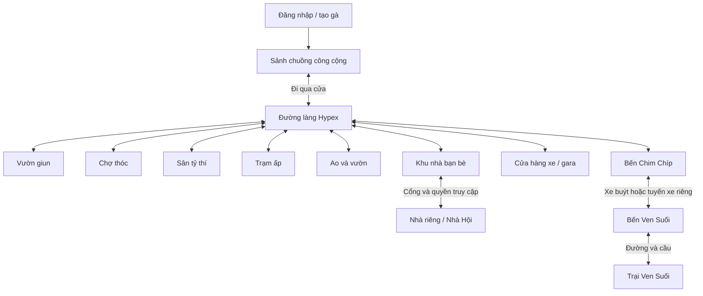

# Hypex Farm — Plan dựng lại giao diện theo bộ ảnh 2

Ngày: 02/11/2026 · Phiên bản 1.0 · Trạng thái: **đặc tả để triển khai, chưa phải giao diện đã hoàn thành**.

## Trạng thái triển khai (02/11/2026, lượt 1)

Thang đo theo mục 13: chưa dựng / dựng khối / đạt mỹ thuật / nối tương tác / đã kiểm chứng. Lượt này dựng bằng hình học thủ tục trong Three.js r128 (không có model/texture vẽ tay), nên mọi cảnh mới ở mức **dựng đủ bố cục và vật chủ đạo**: so cạnh ảnh mẫu thì đúng bố cục, vật liệu và tông màu, nhưng chưa đạt độ chi tiết của ảnh render. Ảnh đối chiếu (bên trái ảnh game, bên phải ảnh mẫu) nằm trong [docs/visual-qa/bo-2/](docs/visual-qa/bo-2/).

| Mã | Cảnh | Đã có | Còn thiếu so với ảnh |
| --- | --- | --- | --- |
| B02-02 | Sảnh | Camera trong nhà thấy mặt dưới mái; mái phụ trên bục, biển HYPEX FARM treo; lối ván; 40 ổ; máng ăn/nước; vách lưới; đèn lồng có quầng sáng | Gà/ổ chưa mềm như ảnh; nền ít rêu hơn |
| B02-01 | Chợ thóc | Quầy giun + Lợn Ủn sau quầy (khay giun, cân, bảng phấn); quầy thức ăn có mái rơm riêng, rổ thóc, thùng nước, cờ bông lúa; quầy trang phục có giá treo áo/váy, mũ; lối ván; rơm, thùng ở tiền cảnh | Hàng hoá còn đơn giản |
| B02-03 | Vườn giun | Đất đào sẫm, ụ đào theo điểm server; lán Lợn Ủn sau phải (server dời NPC + thêm vật cản); lối ván tới lán; mái che + máng bên trái; gốc chặt, biển giun; gà cầm xẻng | “+1 giun” vẫn là thông báo HUD cũ |
| B02-04 | Sân tỷ thí | Vòng phấn, Chó Mực sau vòng (server dời NPC); khán đài có mái + khán giả trái; ghế, kiện rơm, cờ biểu tượng phải; rào trước | Bảng điểm 3D/hiệu ứng KO theo trận chưa làm |
| B02-05 | Nhà Hội | Nhà mái rơm, bàn bản vẽ + đèn, ổ quanh bàn, ổ chủ dưới cờ hội, bảng “Nhiệm vụ chung”, xe kéo gỗ, đá, bao | Chỉ kiểm bằng cảnh dựng thử trong trình duyệt (chưa lập hội thật để chụp) |
| B02-06 | Trạm ấp | Lối ván tới quầy Vịt Bông (đội mũ rơm) dưới mái phụ; 6 ổ trứng hai bên; bao, rổ, bảng phấn; gà con | Nút “E Ấp trứng” tại ổ chưa làm (ấp vẫn qua Vịt Bông) |
| B02-07 | Khu nhà bạn bè | Cổng + biển lớn “KHU NHÀ BẠN BÈ”; đường đất có ván; 4 chuồng mái rơm có sân rào, luống rau, cờ; khung nhà Bò Mộc đang dựng (server dời NPC + vật cản); Nhà Hội phía sau | |
| B02-08 | Ao và vườn | Ao bờ đá, lau sậy, lá súng, sen; cầu câu với hai gà cầm cần; 3 luống rau có rào; hai quầy mái rơm phía sau; cây cam; tên khu đổi thành “Ao và vườn” | **Gameplay câu cá / trồng rau chưa có** (chỉ là cảnh) |
| B02-09 | Bến xe | Nhà chờ mái rơm có ghế ổ + biển “BẾN XE CHIM CHÍP”, quầy Chim Chíp, bảng tuyến; xe buýt ô-liu lớn bên phải, lối ván lên cửa; vật cản server theo nhà chờ và xe | |
| B02-10 | Ven Suối | Chuồng dài mái rơm bên trái (vật cản server mới); suối đá, bọt, lau; cầu ván có đèn ở chỗ qua; ụ đào; biển “Trạm về Hypex” | Chỉ kiểm bằng cảnh dựng thử (chưa đi xe sang để chụp); suối thẳng, chưa chéo như ảnh |
| B02-11 | Cửa hàng xe | Nhà mái rơm, quầy thợ + tường dụng cụ, lốp treo; ba ô trưng bày kẻ vạch (xe đạp, xe máy, ô tô) + biển hình xe; chồng lốp; máng nước, rơm; rào trước | |

Chung cho mọi cảnh: tone mapping ACES + trời gradient, núi xa, sương theo khoảng cách, viền tối nhẹ; mái rơm có mặt trên/dưới riêng; vách lưới mắt cáo ~15 cm; lối ván ghép so le; camera đối chiếu từng khu (kèm FOV riêng) và camera đi theo thấp hơn dưới mái; mái chỉ mờ khi thật sự che gà; cổng vòm ẩn hẳn khi che (không còn chữ mờ). HUD: biển tên khu treo xích + đèn, icon công cụ có màu riêng.

Hiệu năng (Chromium chạy CPU, 1440 × 810, tính cả lượt bóng đổ): sau khi gộp mesh theo vật liệu và gộp khớp NPC, sảnh ~490, chợ ~570, sân PK ~670, bến xe ~480 lượt vẽ (trước đó 860–1.130). **Chưa đo FPS trên GPU thật hay điện thoại.**

Công cụ chụp đối chiếu: chạy máy chủ với `-devwarp` để gửi `{t:'act',a:'go',to:<khu>,id:'devwarp'}` nhảy thẳng tới khu. Cờ này tắt mặc định, không dùng khi chơi thật.

## 1. Mục tiêu và thứ tự ưu tiên

Dựng lại cảnh game và HUD để khi đứng đúng vị trí, chọn đúng góc camera, ảnh chụp trong game khớp sát ảnh minh họa tại `assets/illustrations/bo-2`. Người chơi vẫn đi lại và xoay camera trong thế giới 3D thật. Chất lượng đích là **gà hoạt hình mềm, môi trường nông trại chi tiết, gỗ–rơm–đất mộc mạc, ánh sáng ấm và giao diện màu gỗ/kem**.

Đã xem trực tiếp cả 11 PNG, cùng mã hiện tại của `world.js`, `scenery.js`, `models.js`, `camera.js`, `map.js`, `index.html` và phần bố cục server. Nhận xét hiện trạng bên dưới dựa trên mã; lượt lập plan này không chạy lại game hoặc đo hiệu năng.

Thứ tự áp dụng:

1. Bộ 2 quyết định diện mạo, bố cục góc chụp, vật liệu, hình dáng nhân vật và HUD. Bộ 1 chỉ còn là tài liệu lịch sử khi có khác biệt.
2. Tài liệu này quyết định cách chuyển các ảnh thành cảnh tương tác, cách xử lý những chi tiết không thống nhất giữa ảnh và tiêu chí nghiệm thu.
3. [PLAN_THE_GIOI_3D.md](PLAN_THE_GIOI_3D.md) tiếp tục quy định thế giới liền, camera điều khiển, di chuyển và nhiều người chơi; các thông số hình ảnh xung đột phải hiệu chỉnh theo bộ 2.
4. [PLAN.md](PLAN.md) và luật server hiện có tiếp tục quy định tài khoản, mana, kinh tế, PK, đồ, nhà, xe và Hội Gà. Đợt này không tự thay giá, xác suất, sức chứa hoặc tiến độ người chơi.

**“Giống y hệt” được chuyển thành mục tiêu có thể kiểm tra:** đủ 11 góc chụp tương ứng, cùng viewport, cùng bố cục chủ đạo, cùng hình dáng và nhóm chi tiết, cùng phong cách ánh sáng/HUD. Ảnh 2D không cung cấp mặt sau công trình, thông số camera, bản đồ toàn vùng hay mọi trạng thái UI; các phần đó cần thiết kế bổ sung và được đánh dấu trong plan. Không dùng ảnh nguyên tấm làm nền giả 3D, không lấy một điểm số pixel làm bằng chứng duy nhất cho độ giống.

## 2. Danh mục chuẩn tham chiếu

Tất cả ảnh có kích thước **1672 × 941 px**. Xem ảnh gốc tại [gallery bộ 2](assets/illustrations/bo-2/README.md). Số thứ tự không trùng bộ 1.

| Mã | Tệp nguồn trong `assets/illustrations/bo-2/` | Cảnh trong game | Điểm nhận diện bắt buộc |
| --- | --- | --- | --- |
| B02-01 | Chợ thóc và quầy giun-1.png | `market` | Quầy giun/Lợn Ủn trái, thức ăn giữa, quần áo phải; lối ván giữa |
| B02-02 | Sảnh chuồng gà Hypex Farm-2.png | `lobby` | Mái lớn bao khung hình, hai khối ổ rơm, đường ván, Cụ Cục trên bục |
| B02-03 | Vườn giun nhộn nhịp-3.png | `garden` | Đất sẫm nhiều ụ đào, gà cầm xẻng, lán Lợn Ủn phía sau bên phải |
| B02-04 | Sân tỷ thí gà cùng chó Mực-4.png | `arena` | Vòng phấn, chó trọng tài, khán đài hai bên, bảng điểm và KO |
| B02-05 | Nhà Hội Gà Ấm Cúng-5.png | `guildhall` | Bàn bản vẽ trung tâm, ổ quanh bàn, cờ gà sau, bảng việc phải |
| B02-06 | Trạm ấp trứng mộc mạc-6.png | `hatchery` | Ổ trứng lớn hai bên lối ván, Vịt Bông ở quầy cuối, gà con |
| B02-07 | Khu nhà bạn bè-7.png | `neighborhood` | Cổng trước, đường giữa, sân nhà hai bên, Bò Mộc/công trình bên phải |
| B02-08 | Ao và vườn Hypex Farm-8.png | `park` | Ao trái, cầu sàn câu cá, rau phải, hai quầy phía sau |
| B02-09 | Bến xe Chim Chíp giữa đàn gà-9.png | `station` | Mái chờ trái, quầy vé, xe buýt xanh ôliu lớn bên phải |
| B02-10 | Trang trại Ven Suối-10.png | `vensuoi` và đường nối `vs_station` | Chuồng trái, suối chéo phải, cầu gỗ, trạm về ở xa |
| B02-11 | Cửa hàng xe giữa nông trại gà-11.png | `garage` | Xe đạp xanh trái, scooter đỏ giữa, ô tô xanh phải, bàn thợ phía sau |

Không tạo lại ảnh nguồn hoặc ghi đè PNG. Khi triển khai, lưu tài nguyên runtime riêng trong `client/assets/`; `assets/illustrations/bo-2` vẫn là nguồn đối chiếu.

## 3. Các quyết định chung rút ra từ ảnh

### 3.1. Kiến trúc và chiều sâu

- Camera đứng gần cửa/tiền cảnh, nhìn vào không gian có chiều sâu. Các ảnh nội thất thấy **mặt dưới mái rơm**, xà gỗ, cột lớn và cảnh đồng quê xuyên qua vách lưới.
- Mái không phải tấm tam giác nhẵn. Có độ dày, nhiều lớp rơm chồng, mép tua không đều, bóng lên kèo phía dưới.
- Vách là cột/xà gỗ kết hợp lưới mắt cáo; không dùng vách gỗ kín thấp bao quanh toàn bộ sảnh như một sân trống.
- Sàn chính là đất nâu, mảng ẩm/rêu, rơm rải, cỏ, sỏi. Lối đi bằng các tấm ván lệch nhẹ, có vân và khe, dẫn mắt tới khu chính.
- Mỗi ảnh có tiền cảnh–trung cảnh–hậu cảnh rõ: hàng rào/cột/mái gần máy, nhân vật và vật tương tác ở giữa, cây/đồi/chuồng xa phía sau.
- Đồ vật tạo cụm có chủ đích: thùng cạnh bao thóc, dụng cụ gần bàn thợ, cỏ mọc ven hàng rào. Không rải đều ngẫu nhiên lên mọi bề mặt hoặc chắn đường đi.

### 3.2. Nhân vật

Gà thân hình quả lê tròn mập, chân ngắn, cánh mềm, mào đỏ chia múi, mỏ vàng cam, mắt đen có điểm sáng. Có nhiều màu lông và phụ kiện dễ nhận ra: khăn, túi, áo, mũ. Vật liệu mờ và bóng đổ mềm, không thấy các mặt đa giác lớn trên thân ở khoảng nhìn chơi bình thường.

Lấy một gà trưởng thành làm thước đo `H`; tiếp tục thử với H = 1,35 đơn vị của thế giới hiện tại. Ổ thường rộng khoảng 1,3–1,6H, đệm rơm thấp; quầy cao khoảng 0,65–0,9H để nhìn thấy mặt người bán. Đây là tỷ lệ dựng thử, không phải số đo lấy được từ ảnh.

NPC phải phân biệt bằng hình dáng: Lợn Ủn hồng mặc yếm xanh, Chó Mực đen có vòng cổ, Vịt Bông sáng màu đội mũ, Bò Mộc có sừng và mũ bảo hộ, Chim Chíp ở quầy vé. NPC điều hành có vị trí thật, khoảng tương tác thật. NPC sinh hoạt chỉ làm cảnh không được tính là người online hoặc giả thành tài khoản người thật.

### 3.3. Ánh sáng, màu và vật liệu

| Thành phần | Quan sát từ ảnh | Cách dựng dự kiến |
| --- | --- | --- |
| Ánh sáng ngoài trời | Ban ngày ấm, nền xa xanh nhạt, bóng có độ mềm | Một nguồn nắng chính, ánh môi trường, sương theo khoảng cách; hiệu chỉnh từng cảnh |
| Trong chuồng | Mái tối hơn sân; nhân vật vẫn đọc rõ; đèn vàng tạo điểm nhấn | Ánh nền dưới mái + bóng tĩnh/AO được bake + đèn phát sáng; hạn chế số đèn động |
| Gỗ | Nâu đậm ở cột, sáng hơn ở mặt ván; có thớ và cạnh mòn | Bộ texture màu/normal/roughness, UV theo thớ; cạnh có độ bo thật ở đồ gần |
| Rơm | Vàng mật ong; mép ổ tua ra, lòng ổ lõm và tối | Mesh khối chính + cụm sợi ở silhouette + texture chi tiết; tránh hàng nghìn sợi thành draw call riêng |
| Đất | Nâu ẩm xen rêu, sỏi, cỏ và rơm; đường mòn rõ | Lớp vật liệu nền, mask vùng, decal/mesh cụm chi tiết, không chỉ một texture lặp |
| Lưới | Mắt cáo nhỏ, nhìn xuyên ra cây phía sau | Khung 3D; alpha-test cho lưới xa, geometry chọn lọc ở gần; kiểm tra rung/moiré |
| Nước | Ao xanh lam lục có phản chiếu, suối có dòng/bọt | Mặt nước có normal chuyển động, phản chiếu tiết kiệm; bọt ven đá, lá súng ở ao |
| Hậu cảnh | Cây nhiều lớp, đồng và đồi giảm tương phản theo xa | Cụm cây 3D/LOD và đường chân trời; không để mép đất trống lộ ra khi xoay |

Bảng màu khởi điểm **ước lượng bằng mắt, chưa lấy mẫu pixel**: gỗ tối `#51351F`, gỗ trung `#89582F`, bảng HUD `#A96F42`, rơm `#C99A42`, đất `#65512F`, cỏ `#637442`, kem `#F4EBD5`, xanh nút `#35614C`, vàng XP `#F5A332`, đỏ mana `#D94D42`. Chốt lại bằng ảnh render ở cùng điều kiện; màu hex đơn lẻ không đủ tái tạo ánh sáng.

## 4. Camera: khớp ảnh và vẫn chơi tự do

### 4.1. Hai bộ góc nhìn

**Góc đối chiếu:** mỗi cảnh có một cấu hình cố định lưu vị trí, điểm nhìn, FOV, viewport, ánh sáng, vị trí nhân vật và thời điểm hoạt ảnh. Đây cũng là góc giới thiệu khu lần đầu nếu không khiến người chơi mất dấu gà của mình.

**Góc chơi:** theo gà/xe, kéo xoay 360°, thay pitch, zoom, chống vật cản, đặt lại góc. Khi người chơi di chuyển khỏi khung hình tham chiếu, camera chuyển mượt theo nhân vật. Không liên tục ép họ về góc ảnh.

Phối cảnh là lựa chọn dựng thử phù hợp với ảnh. Không thể suy ra chính xác tiêu cự hoặc vị trí máy từ PNG; cần dựng khối và khớp đường hội tụ của cột, xà, lối ván. Bắt đầu thử FOV dọc 40–50°, pitch nhìn xuống 15–30°; cảnh ngoài trời có thể cần 20–35°. Đây là khoảng tìm kiếm, không phải ràng buộc nếu render cho thấy sai.

Camera sảnh hiện có pitch `.8 rad` (~46°), focus `[0,1,6]`, radius 31. Phải hiệu chỉnh đồng thời chiều cao mái, vị trí máy, FOV và kích thước nhân vật để đạt bộ 2; không chỉ giảm pitch rồi giữ mọi thông số còn lại.

### 4.2. Mốc bố cục sảnh ở 1672 × 941

Các tọa độ dưới đây là **ước lượng nhìn trên ảnh**, dùng để khởi tạo bản dựng; bước R0 sẽ đo lại trước nghiệm thu. Gốc trên trái; x/y tính theo phần trăm khung hình.

| Mốc | Vị trí tham chiếu ban đầu |
| --- | --- |
| Trục lối ván | x ≈ 50%; rộng dần từ khoảng 5% ở gần bục tới 18% ở tiền cảnh |
| Bục và Cụ Cục | Cụ Cục x ≈ 50%, y ≈ 36%; mặt bục trong khoảng y 38–42% |
| Bảng HYPEX FARM trong cảnh | Trung tâm x ≈ 50%, y ≈ 29% |
| Hai khối ổ rơm | Trái x ≈ 13–43%, phải x ≈ 56–84%; y ≈ 44–79% |
| Mái hai phía | Bao hai góc trên, dẫn vào khoảng sáng giữa; mặt dưới mái luôn nhìn thấy |
| Máng ăn và máng nước | Ăn phía trước trái, nước phía trước phải |
| Gà tiền cảnh | Cao khoảng 8–11% chiều cao ảnh, tùy vị trí; gà giữa cảnh nhỏ dần hợp phối cảnh |

Giữ sức chứa vận hành 50 người và 40 ổ hiện có, nhưng số ổ nhìn thấy trong ảnh phụ thuộc camera. Không thêm ổ vào lối ván để ép đủ 50 ghế, không mặc định mọi gà phải xuất hiện trong một góc chụp.

### 4.3. Điều khiển và mái che

- Giữ WASD, click/chạm đất tìm đường, kéo xoay, wheel/pinch zoom, E tương tác, M bản đồ. Chữ hướng dẫn phản ánh đúng tính năng đang có; không sao chép chỉ dẫn Space/Shift từ ảnh nếu chưa có hành vi tương ứng.
- Mái chia thành các phần có mặt trong/mặt ngoài, không ẩn toàn bộ mái khi đổi sang góc chơi. Camera bên trong nhìn thấy trần thật; chỉ phần nằm giữa camera và nhân vật mới cần mờ/cắt có chọn lọc.
- Thay kiểm tra hộp bao của cả công trình bằng vật cản đủ chi tiết, tránh camera đứng trong chuồng mà toàn bộ tường/mái bị mờ.
- Mỗi cột/vách cản phải có chuyển mờ ổn định; không nhấp nháy, không mất bóng cả phòng. Material dùng chung không được làm công trình khác mờ theo.
- Góc sau, trái, phải và ngoài cửa vẫn có kiến trúc đầy đủ. Nhân vật không nổi trên mặt đất, không xuyên mái khi ngồi xe hay lên bục.

## 5. HUD chuẩn hóa theo bộ 2

Lấy **ảnh sảnh B02-02** làm mẫu vị trí và chất liệu chính. Các ảnh còn lại xác nhận cùng bố cục, nhưng không đồng nhất số liệu, icon và chữ. Các kích thước dưới đây là khởi điểm ước lượng ở viewport gốc; cần đo bounding box trong R0.

| Khối | Kích thước/vị trí ban đầu | Thiết kế và dữ liệu |
| --- | --- | --- |
| Hồ sơ trên trái | x16–20, y20–26; khoảng 264×120 px | Hai lớp viền gỗ, chân dung gà thật, tên, huy hiệu Cấp, XP cam và Độ no đỏ |
| Bảng tên khu trên giữa | Tâm x836, y55; khoảng 300×74 px | Tấm gỗ treo dây/xích, hai đèn nhỏ, tên trắng; phụ đề ngắn khi cần |
| Ví thóc trên phải | Cách phải 20 px, y18; khoảng 134×44 px | Icon bông thóc nhất quán, số tiền thật và chữ “thóc” |
| Minimap dưới ví | Cách phải 20 px, y70; khoảng 176×160 px | Khung gỗ bo tròn, nền giấy kem, đường và chấm màu, tên khu ở chân |
| Trạng thái dưới minimap | Chính giữa minimap, khoảng y230 | Nhãn kênh/sức chứa hoặc nhắc phím M, lấy từ server, không cộng NPC vào online |
| Bộ công cụ phải dưới | Cách phải 16–22 px; từ y620, tùy viewport | Sáu nút kem thành 2 cột × 3 hàng, mỗi nút 44–48 px; hàng hành động phụ và nút xanh “…” |
| Chat giữa dưới | Tâm x836; rộng khoảng 438 px, cao 50 px; cách đáy 24 px | Nền kem, góc bo lớn, placeholder xám, nút gửi máy bay giấy xanh |
| Hướng dẫn thao tác | Trên chat 10–16 px | Chữ nhỏ sáng có nền/bóng nhẹ; thu gọn sau khi biết chơi |
| Công cụ góc dưới trái | x20, cách đáy 24 px; khoảng 132×48 px | Nhóm nút kem gọn: camera, bản đồ, ẩn HUD; mobile thay bằng joystick |

Các quyết định chủ động để giao diện nhất quán:

- XP màu cam nằm trên, mana **“Độ no”** màu đỏ nằm dưới; không tạo thêm HP chỉ vì ảnh dùng icon tim. Hiện giá trị thật, có tooltip/tên hỗ trợ đọc màn hình.
- “32 thóc”, “Tuna”, “Cấp 3”, “18/50”, “18 : 15” là dữ liệu minh họa. Bản chạy thật không hardcode. Chế độ QA riêng có thể cố định dữ liệu để chụp ảnh, không ghi vào tài khoản thật.
- Chỉ dùng “thóc”, sửa chữ “hạt” ở ảnh Ven Suối; thống nhất “Cấp” thay cho Lv/Lv.3, sửa lỗi chính tả của ảnh.
- Sáu nút cố định: Túi đồ, Nhiệm vụ, Cửa hàng/điểm đến chợ, Sổ giun, Tủ đồ, Bạn bè. Icon theo một bộ vẽ thống nhất; không dùng emoji hệ điều hành làm thành phẩm vì hình thay đổi giữa máy.
- Nút cửa hàng khi đang ở xa chỉ cho xem danh mục/chỉ đường. Mua/bán vẫn phải đứng gần quầy tương ứng. Bạn bè/Hội/nhà không trở thành lối dịch chuyển bỏ qua bản đồ.
- “…” chứa thư, Hội Gà, hướng dẫn, chụp ảnh, âm thanh, cài đặt và công cụ khác. Giữ đủ chức năng đang có dù giảm số nút thường trực.
- Tên NPC chỉ bật ở gần/đang chọn; nhãn người chơi ngắn trên nền nâu nhỏ như sảnh mẫu. Không gắn biển chữ khổng lồ cho mọi vật. Bubble hướng dẫn chỉ một NPC ưu tiên tại một thời điểm.
- Prompt E gắn gần đối tượng như “Bán giun”, “Ấp trứng”, “Xem tuyến”, “Xem xe”; bị che khuất hoặc ngoài tầm thì không hiện. Khi ngoài tầm, click dẫn tới vị trí tiếp cận hợp lệ.

Các bảng mua đồ, túi, bạn bè, bản đồ lớn, đăng nhập và tạo gà **không có ảnh mở trong bộ 2**. Thiết kế bổ sung dùng khung gỗ mỏng, giấy kem, chữ nâu, nút xanh/vàng; giữ chức năng và thứ tự tác vụ. Không coi đó là sao chép trực tiếp từ ảnh.

Desktop đối chiếu ở 1672×941, kiểm tra thêm 1366×768 và 1920×1080. Mobile ưu tiên ngang, kiểm tra thêm dọc 390×844: hồ sơ thu gọn, minimap có thể gập, công cụ mở khay, chat trên vùng bàn phím. Giữ vùng chạm tối thiểu 44 CSS px; không thu nhỏ toàn bộ HUD desktop thành ảnh. Khi gõ chat hoặc mở bảng không điều khiển gà xuyên UI.

## 6. Đặc tả từng cảnh

### B02-02 — Sảnh chuồng gà: cảnh mẫu phải hoàn thành đầu tiên

**Bố cục:** đối xứng quanh lối ván; máy ở đầu chuồng nhìn về bục. Mái dốc hai bên lấp góc trên, dãy cột/lưới chạy về sau. Đầu chuồng có mái thấp phía sau, biển HYPEX FARM, ổ lớn và Cụ Cục trên sàn gỗ. Hai khối ổ thường tách khỏi đường giữa, có một số gà đứng trò chuyện ở tiền cảnh.

**Asset cần có:** bộ mái rơm có mặt trong, kèo/cột/giằng, lưới mắt cáo, sàn bục/bậc lên, ván đường, ổ rơm nhiều biến thể, máng thóc trước trái, máng nước trước phải, ghế dọc vách, đèn treo, thùng, bao, đống rơm, sỏi/cỏ/rơm nền. Biển và chữ dựng riêng cho sắc nét; không lấy chữ méo từ texture ảnh.

**Sinh hoạt:** Cụ Cục ngồi ổ chủ; 6–8 NPC thường trú đứng/ngồi, nghiêng đầu, đi đoạn ngắn, nhường ổ cho người chơi. Ngồi ổ do server xác nhận; tư thế chân/cánh và vị trí mông khớp lòng ổ. Hiệu ứng nhân vật mới vào nhẹ, không che khung hình.

**Chốt kỹ thuật:** bắt đầu trên mặt bằng 32×42 hiện có; thay tỷ lệ khi khớp camera chứng minh cần thiết. Lối gỗ phải đủ hai gà tránh nhau. Thêm collider cột và bục, giữ thông lối vào và hai mép ổ. Cảnh đông vẫn đọc được lối chính; mục tiêu 50 người không được thay bằng 50 NPC.

**Nghiệm thu riêng:** có mái nhìn thấy từ góc chuẩn; chủ trên bục ở đúng trục; ổ không giống vòng nhựa nhẵn; nền không là mảng vàng trống; cả hai máng ở đúng phía; chuyển góc không làm mất kiến trúc hoặc chặn thao tác ngồi.

### B02-01 — Chợ thóc và quầy giun

**Bố cục:** mái chung phủ đầu khung; quầy giun chiếm bên trái, thức ăn ở giữa xa, quần áo bên phải. Đường ván từ dưới giữa đi tới quầy giữa; khoảng đất hai bên đủ gà mua hàng.

**Chi tiết:** Lợn Ủn sau khay giun hồng và cân đồng; bảng hình giun phía trước. Quầy thức ăn có bao thóc, giỏ hạt/rau, thùng nước. Quầy trang phục có thanh treo áo, váy, mũ và túi trên bàn; hàng rào lưới và đồng quê phía sau.

**Tương tác:** prompt bán giun ở đúng quầy; mua thức ăn và thời trang ở hai quầy riêng. Thử đồ trên gà 3D, giữ giới tính hồ sơ và toàn bộ lựa chọn trang phục hiện có. Giá, số lượng, thiếu thóc, thành công/thất bại lấy từ server. Cân/giỏ là trang trí, không tạo quầy trùng với collider NPC.

**Nghiệm thu riêng:** nhìn không cần chữ vẫn phân biệt ba loại quầy; không thay hàng áo treo bằng một biển “Trang phục”; avatar không xuyên mặt bàn khi đứng mua.

### B02-03 — Vườn giun

**Bố cục:** đất đào ở trái và giữa; lán hướng dẫn ở góc phải phía sau; lối ván chạy chéo từ trước phải tới lán. Mái/cột phía trái và hàng rào tạo khung; nhiều ụ đất khác nhau thay vì lưới ô vuông phẳng.

**Chi tiết:** Lợn Ủn yếm xanh ở lán, bảng giun, kệ dụng cụ, xẻng tựa vách, xô và thùng giun; giun ló trên ụ, đất mới đào đậm màu, cỏ và sỏi chen kẽ.

**Hoạt ảnh:** bước tới mép ụ → cầm xẻng → xúc đất → đất bắn vừa phải → kết quả thật. Hiện “+1 giun” gần ụ sau khi server xác nhận; đổi sắc/viền và hoạt ảnh nâng giun khi giun hiếm. Thẻ khoe nêu loại/độ hiếm/kỷ lục thật, có giới hạn tần suất để không lấp cảnh đông.

**Phân vai:** ảnh có Lợn Ủn ở cả chợ và vườn. Giữ hai điểm phục vụ rõ nhãn “Thu mua”/“Hướng dẫn đào”, dùng vai trò NPC theo khu; không tự cho NPC chạy xuyên hai nơi hoặc thay luật bán hàng.

**Nghiệm thu riêng:** ụ đào khớp điểm server và có trạng thái sẵn sàng/hồi đất; không hiện giun hiếm trước kết quả; thiếu mana/đầy túi có phản hồi rõ, không trả thưởng lặp.

### B02-04 — Sân tỷ thí

**Bố cục:** vòng phấn elip do phối cảnh ở trung tâm; gà thắng trái, gà KO phải, Chó Mực phía sau giữa. Khán đài gỗ trái có mái, khán giả phải và tiền cảnh sau rào. Bảng tên khu ở trên; bảng điểm riêng bên dưới.

**Chi tiết:** cờ vải hình gà, thùng, bó rơm làm ghế, đèn cột, đất nén với vệt phấn không quá hoàn hảo. Chó Mực đen, dáng ngồi và huy hiệu cổ rõ.

**Trạng thái:** chưa đấu chỉ có lời mời/luật; đang đấu hiện tên/chân dung, thời gian và điểm; kết thúc gà thắng dang cánh, gà thua nằm nghiêng có sao vàng rồi đứng dậy. Bảng 18:15 là ví dụ điểm, không mặc định là đồng hồ. Mini-game mổ nhanh/úp ngửa hiện bảng điều khiển khi đã nhận thách đấu.

**Nghiệm thu riêng:** chỉ server kết luận thắng thua; khán giả xem đúng kết quả; góc chụp có tiền cảnh tạo chiều sâu nhưng không che vùng PK; người không đồng ý không bị kéo vào trận.

### B02-05 — Nhà Hội Gà

**Bố cục:** nhà có mái và vách lưới, đường ván vào; bàn gỗ lớn giữa đặt bản vẽ và đèn; ổ rơm bao quanh bàn; bục/ổ ở sau dưới cờ gà. Bảng “Nhiệm vụ chung” phía sau phải, xe kéo chở gỗ trước trái, vật liệu dọc phải.

**Chi tiết:** cuộn bản vẽ, bút/dụng cụ, hộp và bao, đống đá, gỗ bó, dây thừng và hàng rào tiền cảnh. Có điểm ngồi quanh bàn đủ khoảng cho gà.

**Tương tác:** bảng việc/quỹ/công trình và quyền hội dùng server hiện có. Tên/cờ hội tùy hội; trạng thái nâng cấp làm đổi vật liệu/công trình có thật. Tách scene builder riêng thay cho nền sân và một bàn đơn giản hiện tại.

**Nghiệm thu riêng:** góc chuẩn nhìn rõ bàn, cờ và bảng việc; nhà hội có định danh/quyền thật; không lẫn vật liệu hoặc thành viên giữa hai hội khi đổi phòng.

### B02-06 — Trạm ấp trứng

**Bố cục:** đường ván giữa tới quầy Vịt Bông, các ổ lớn có trứng hai bên theo chiều sâu. Bao thóc sau quầy, giỏ/kệ bên phải, thùng bên trái, mái và lưới bao trọn không gian.

**Chi tiết:** trứng màu kem có bóng tiếp xúc nằm trong lòng rơm; gà con nhỏ đứng cạnh gà trưởng thành; một gà đang chăm ổ. Vịt Bông đội mũ và mặc áo/yếm xanh.

**Tương tác:** chọn ổ mở trứng, thời gian còn lại và thao tác nhận. Ấp vẫn chạy offline theo server; trứng rung/nứt/nở khi đúng trạng thái, gà con theo chủ, không tạo thú nuôi chỉ bằng animation. Phân biệt ổ người chơi dùng được và ổ trang trí.

**Nghiệm thu riêng:** mỗi giai đoạn có ảnh chụp; gà con đúng tỷ lệ và không chìm sàn; reconnect không nở lại/nhận thưởng hai lần.

### B02-07 — Khu nhà bạn bè

**Bố cục:** nhìn qua cổng gỗ tiền cảnh vào đường đất dài; chuồng có sân hàng rào hai bên, luống rau sát sân. Bảng khu bên trái cổng. Góc phải xa là khung nhà đang xây cùng Bò Mộc trên bàn/sàn làm việc.

**Chi tiết:** cờ màu hình gà từng nhà, máng ăn, ổ rơm, đèn cột, chậu/giỏ rau, thanh ván trên đường, khung mái và gỗ nguyên liệu ở công trình.

**Tương tác:** biển đất hiển thị chủ/quyền thăm; tiếp cận đúng nhà rồi vào phiên nhà riêng. Công trình đang xây thể hiện tiến độ server, hợp đồng thợ và quyền thao tác. Các nhà xa chỉ làm cảnh cần có dấu hiệu phân biệt, không mạo danh nhà của người chơi thật.

**Nghiệm thu riêng:** đường giữa thông thoáng; có công trình một phần đúng ảnh; mời bạn/khóa cửa/đuổi khách vẫn hoạt động; người ngoài không sửa đồ nhà.

### B02-08 — Ao và vườn

**Bố cục:** ao lớn nửa trái, sàn gỗ thấp ở trước trái nối đường giữa; luống rau bên phải chia ô bởi gỗ; hai quầy mái rơm phía sau. Cây có quả góc phải, đá/lau/lá súng/sen dọc bờ.

**Chi tiết:** mặt nước phản ánh đèn và cây, cần câu có dây/phao, rau củ nổi trên đất, sọt thu hoạch và dụng cụ. Lối đi quanh ao thật, nước là vùng không đi bộ được trừ cầu.

**Phần mở rộng ngoài luật hiện có:** ảnh thể hiện “E Câu cá” và chăm/thu hoạch rau. Tìm trong mã ở lượt này chưa thấy luật câu cá/trồng rau; cần một hạng mục gameplay riêng để hoàn thiện tương tác như ảnh. Đề xuất tối thiểu: điểm câu, trạng thái chờ/cắn câu/nhận kết quả; ô rau gieo/chờ/chín/thu hoạch; cấu hình sản lượng và phần thưởng do server quyết định. Giá, thời gian, sức chứa và loại vật phẩm phải có bảng cân bằng trước khi đưa vào kinh tế, không tự mặc định.

**Điều kiện giao:** bản dựng mỹ thuật có thể dùng NPC câu cá/chăm rau để đối chiếu; bản hoàn thiện tương tác không được để prompt E giả. Chỉ đánh dấu xong toàn bộ cảnh khi tác vụ hoạt động hoặc ghi rõ đang thiếu gameplay, không gộp thành “đã xong”.

### B02-09 — Bến xe Chim Chíp

**Bố cục:** nhà chờ và quầy vé bên trái; xe buýt xanh ôliu chiếm gần nửa phải, đầu xe quay chéo về máy. Cửa xe và cầu lên nằm giữa; đường xe chạy tiếp phía sau, có hàng rào và cây xa.

**Chi tiết:** mái rơm dày, bảng BẾN XE CHIM CHÍP, ghế dài đặt đệm ổ, bảng tuyến đứng, chim bán vé, tài xế, cửa kính nhìn thấy ghế, đèn xe, bánh/lốp, mép sơn mòn; vài gà xếp gần cửa.

**Tương tác:** “Xem tuyến” ở quầy; hiển thị đích, số ghế, thời gian, lượt free còn lại, giá lượt tiếp theo. Xe cập bến → mở cửa → lên/nhận ghế → chờ → đóng cửa → khởi hành. Đồng bộ trạng thái server; animation không tự khấu trừ tiền hoặc tự chuyển vùng.

**Giữ luật:** 8 ghế, 3 lượt free/ngày rồi 10 thóc/lượt, về Hypex miễn phí theo cấu hình hiện tại; số cửa sổ/ghế nhìn thấy của mô hình không thay sức chứa. Hủy chuyến, đầy xe, reconnect và hoàn tiền có UI rõ.

### B02-10 — Trang trại Ven Suối

**Bố cục:** chuồng dài mái rơm và lưới bên trái; bãi đào trước trái; suối chạy chéo từ giữa xa xuống phải trước. Cầu ván bắc ngang suối ở trung cảnh, trạm về nằm ở hậu cảnh gần giữa. Đường đi phải đọc được từ bãi đào qua cầu tới trạm.

**Chi tiết:** bờ đá không đều, lau và hoa trắng, dòng nước có bọt quanh đá, cột cầu buộc dây thừng, đèn vàng, máng dọc chuồng, ụ giun đặc sản và đàn gà.

**Tương tác:** cầu có collider/mặt đi đúng, không bơi hoặc đi xuyên suối; đào đặc sản đúng region. Trạm về là địa điểm thật; bố cục cảnh và `vs_station` phải đồng bộ trên bản đồ. Sửa biển thành “Trạm về Hypex” rõ nghĩa.

**Nghiệm thu riêng:** camera thấy đồng thời chuồng–suối–cầu–trạm; đi bộ được tuyến liên tục; xuống xe ở trạm đúng vùng; về trại không mắc kẹt khi hết thóc.

### B02-11 — Cửa hàng xe

**Bố cục:** nhà mái rơm khung gỗ, quầy thợ cuối giữa; ba ô trưng bày: xe đạp xanh bên trái, scooter đỏ giữa, ô tô xanh bên phải. Mỗi ô có vạch nền và biển hình xe thấp trước mũi.

**Chi tiết:** xe đạp có giỏ và ghế sau, scooter có yên và gương, ô tô có kính/cửa/bánh/đèn; bảng dụng cụ, lốp treo và chồng lốp bên phải, kệ/hộp phía trái, máng nước sát mép.

**Tương tác:** “Xem xe” mở thông tin, giá, ghế, sở hữu và thao tác mua; lấy/cất tại điểm đỗ. Xe trưng bày riêng với xe của người chơi; không spawn hai xe chồng nhau. Ghế hành khách, lên/xuống, bánh quay và hướng lái gắn vào rig.

**Nghiệm thu riêng:** nhìn rõ ba hình dáng xe ở đúng thứ tự; giữ sức chứa theo server (xe đạp/xe máy/ô tô theo cấu hình hiện có), người ngồi đúng ghế, xe không lọt vào khu cấm.

## 7. Bản đồ và tổ chức thế giới

Bộ 2 có minimap nhưng không có bản đồ tổng thể đủ chính xác để thay địa lý. **Giữ mạng đường và tọa độ vùng hiện có làm cơ sở**; thay hình dáng công trình, mặt đường và cảnh quan. Nếu cần dời điểm để khớp ảnh, phải dời cả điểm tương tác, collider, đường tìm kiếm và dữ liệu bản đồ trong cùng thay đổi.



- Chợ/vườn/bến và các khu hoạt động vẫn ở ngoài sảnh, đến bằng đường làng. Chọn bản đồ đặt đường đi, không teleport.
- Minimap nền giấy kem nhưng phải vẽ từ cùng tọa độ server: đường, nước, cửa, vị trí mình, điểm đến, bạn ở gần. Không sao chép các chấm ngẫu nhiên hoặc cùng một mạng đường trong ảnh cho mọi khu.
- Bản đồ lớn cùng phong cách, phân lớp trại hiện tại/các trang trại; chọn trại khác chỉ tuyến tới bến/đường liên trại. Lộ trình tránh suối, nhà, hàng rào và vùng cấm xe.
- Nhiều kênh có cùng địa lý; số người theo kênh thật. Đổi kênh giữ quy tắc vị trí hiện có; tài khoản mới vẫn bắt đầu ở sảnh. Tải lại trong thời hạn reconnect không bị cưỡng ép về sảnh.
- 50 người trong một cảnh và 1.000 người nhiều kênh là hai bài kiểm tra khác nhau. Bộ ảnh không chứng minh sức chứa; hình đẹp không đồng nghĩa backend đã chạy nhiều máy chủ.

## 8. Tài nguyên cần sản xuất

### 8.1. Bộ dùng chung

| Nhóm | Sản phẩm bàn giao |
| --- | --- |
| Gà | Mesh gà chuẩn, rig/điểm gắn đồ, màu lông; idle/đi/chạy/ngồi/chào/đào/khoe/KO/đứng dậy/ngồi xe |
| NPC | Cụ Cục, lợn, chó, vịt, bò, chim; animation phù hợp vai trò |
| Kiến trúc | Cột, giằng, khung mái, mái rơm có trong/ngoài, tấm lưới, rào, cổng, bục, bậc, cầu |
| Đồ nghề | Ổ rơm, máng, đèn, bao, thùng, giỏ, xẻng, cân, bàn, ghế, bảng/cờ; biến thể tránh lặp lộ |
| Thiên nhiên | Vật liệu đất/cỏ/rơm, đá, hoa, rau, cây, mép nước, lá súng, cụm hậu cảnh |
| Xe | Xe buýt xanh ôliu, xe đạp xanh, scooter đỏ, ô tô xanh; pivot bánh/cửa và vị trí ghế |
| HUD | Khung hồ sơ, bảng treo, ví, minimap, nút kem, icon, khung prompt, bảng modal; font đủ tiếng Việt |

Mỗi asset có tên/ID, ảnh nguồn tham chiếu, kích thước, pivot, material/texture, LOD, collider hoặc điểm tương tác, trạng thái hoàn thành. Tài nguyên tự làm hoặc có giấy phép phù hợp; lưu nguồn và giấy phép cùng manifest.

### 8.2. Cách dựng khả thi

- Dùng DCC như Blender để dựng các vật thể quyết định độ giống: gà/NPC, mái/ổ rơm, xe, bộ cột–quầy–cầu; xuất GLB nếu chọn quy trình đó. Không giả định 11 PNG tự biến thành mô hình xoay được.
- Giữ dựng bằng code cho bố trí, cây/cỏ/cụm phụ, instancing, điểm tương tác và cấu hình thế giới. Asset đang có chỉ tái dùng khi vượt kiểm tra hình dáng/chất liệu tương ứng.
- Bắt đầu bằng gà + ổ + cột/lưới + một mảng mái + đất + đèn trong cảnh sảnh mẫu. Chốt mẫu này trước khi làm đủ 11 khu để tránh nhân rộng chất lượng sai.
- Texture 1K cho đa số đồ chung, 2K cho phần chủ đạo khi có lợi nhìn thấy; gộp atlas, LOD, tải gần trước. Các con số là ngân sách thử, điều chỉnh theo đo thật.
- Chữ và biểu tượng giao diện phải sắc nét ở nhiều DPI, tách khỏi texture gỗ. Chân dung gà lấy từ model đang mặc đồ, cập nhật khi đổi trang phục.
- Tất cả asset có thể va chạm hoặc nhìn gần phải có mặt sau/mặt dưới đúng. Tỷ lệ thế giới và điểm gắn rig thống nhất trước khi đưa vào game.

## 9. Kế hoạch thay đổi theo mã hiện tại

| File/module | Điều đã xác nhận trong mã | Thay đổi cần làm |
| --- | --- | --- |
| `client/js/scenery.js` | Có builder cho các khu; sảnh dùng vách ván, lối rơm, texture canvas; chưa có kết cấu mái/lưới đúng bộ 2 trong `hall()` | Tách kit môi trường, đổi lối thành ván, dựng mái/lưới, bố trí chi tiết theo từng ảnh; giữ instancing và seed |
| `client/js/models.js` | Các model và material dựng bằng code | Adapter model/rig mới; giữ API trang phục/animation hoặc migrate có tương thích |
| `client/js/world.js` | FOV 45, một nắng + hemisphere/ambient; fade theo hộp bao; Nhà Hội dựng trực tiếp riêng | Asset loading, ánh sáng/cấu hình màu thống nhất, fade từng phần, builder Nhà Hội; dispose tài nguyên đúng |
| `client/js/camera.js` | Có orbit/pitch/zoom/social/follow và kiểm tra vật cản | Profile theo ảnh, lưu camera đối chiếu, xử lý mái có mặt trong, chuyển mode giữ dấu nhân vật |
| `client/index.html`, `client/css/style.css` | HUD hồ sơ/minimap/chat/công cụ đã có; nhiều icon emoji | Skin gỗ–kem, đúng thứ tự chỉ số, icon thống nhất, menu gọn và responsive; giữ ID/binding cần thiết |
| `client/js/ui.js`, `panels.js`, `social.js`, `v11.js` | Bảng và tác vụ gameplay sẵn có | Đồng bộ skin/trạng thái, gắn prompt đúng quầy, bảo toàn luồng xác nhận và lỗi |
| `client/js/main.js`, `input.js` | Điều phối input, người chơi, scene và UI | Nối model/animation, preload và chuyển cảnh; bảo toàn quyền điều khiển, ngăn input xuyên bảng |
| `client/js/map.js`, `navigation.js` | Minimap/bản đồ và tìm đường từ địa lý thật | Vẽ giấy kem nhưng giữ tọa độ chính xác; cập nhật tuyến khi collider thay đổi |
| `server/world.go` | Có vùng/tọa độ/điểm tương tác/collider; sảnh 32×42, cap 50 | Chỉ sửa nơi bố cục cần; giữ ID ổ/quầy/nhà và chuyển đổi an toàn vị trí đang lưu |
| `server/config.go`, luật room/actions | Cap tổng 50 và kinh tế do server kiểm soát | Không đổi cân bằng cùng bản skin; câu cá/rau là phần mở rộng có đặc tả/test riêng |

Kiến trúc đề xuất bổ sung, chưa phải các file đang tồn tại:

```text
client/assets/models/          gà, NPC, kiến trúc, xe
client/assets/textures/        vật liệu và atlas dùng chung
client/assets/ui/              khung và bộ icon
client/js/art/manifest.js      ID, nguồn, preload, kích thước/pivot
client/js/art/materials.js     cấu hình màu và vật liệu
client/js/art/presets.js       camera/ánh sáng theo B02-01…11
client/js/scenes/              builder riêng cho từng khu
docs/visual-qa/bo-2/            shot manifest, ảnh chụp, bảng lỗi và kết quả đo
```

Giữ Go/WebSocket và dữ liệu tài khoản hiện có. Chưa cần đổi framework client hoặc nâng Three.js chỉ để lập lại phong cách. Nếu cần đổi renderer/loader khi triển khai, đánh giá tương thích và kiểm thử riêng. Code hiện có ghi chú về gamma; phải kiểm chứng pipeline màu của texture/màu vật liệu/output bằng cảnh mẫu, không xem ghi chú đó là kết luận áp dụng cho mọi asset mới.

## 10. Hiệu năng và tải tài nguyên

Ngân sách dưới đây là **mục tiêu thử nghiệm**, chưa phải kết quả đo hoặc cam kết mọi điện thoại đều đạt:

- Desktop mục tiêu 60 FPS ở cấu hình cao trên máy chuẩn được ghi rõ; điện thoại mục tiêu 30 FPS ở vừa/thấp. Ghi cả p95 thời gian khung hình, không chỉ FPS trung bình.
- Sảnh 50 người mặc đồ + 6–8 NPC + HUD là cảnh kiểm tra bắt buộc, thêm bến xe có người/xe và ao có nước/cây. Nhiều client mạng không thay thế 50 avatar được render thật trong một viewport.
- Ban đầu đặt ngân sách khoảng 300 draw call ở vừa, 500 ở cao cho góc nặng; vượt thì đo nút thắt trước. Tài liệu hiện trạng nói có góc khoảng 900 draw call; không coi việc thêm nhiều chi tiết là miễn phí.
- Gói vào sảnh đầu mục tiêu không quá 15 MB truyền nén; chưa tải toàn bộ 11 cảnh trước đăng nhập. Có tiến độ tải, retry, cache, tải khu gần khi đi tới; đo trên mạng/thiết bị được ghi trong báo cáo.
- Gộp vật liệu, instance ổ/cỏ/cột, giới hạn đèn đổ bóng, LOD người xa và xe; chỉ cập nhật animation ngoài tầm nhìn khi cần. Fog che xa không tự chứng minh mesh đã ngừng render: cần culling/chunk và số đo renderer.
- Bóng tĩnh/lightmap và bóng nhân vật động dùng phối hợp; tránh mỗi đèn treo là một nguồn bóng động. Hiệu ứng nước, bloom, sương nâng cao giảm theo cấp đồ họa.
- Cấp thấp vẫn giữ silhouette mái, nhân vật, đường và vật tương tác. Giảm cỏ/sợi rơm xa, độ phân giải texture/bóng, phản chiếu trước; không biến thành sân rỗng mất phong cách.
- Bản cao có thể gần chất lượng ảnh hơn; bản thấp nghiệm thu riêng về bố cục/khả năng chơi. Không hạ chất lượng âm thầm rồi kết luận đã khớp ảnh.

## 11. Trình tự triển khai và điều kiện chuyển bước

Các khoảng công dưới đây là ước lượng ban đầu cho phạm vi mỹ thuật/giao diện, tính theo ngày công của người phụ trách. Độ giống của asset và kết quả sảnh mẫu quyết định việc ước lượng lại. Với 1 dev 3D/frontend, 1 artist 3D và hỗ trợ backend/QA, dự trù khoảng **8–12 tuần lịch**; chưa bao gồm một hệ câu cá/trồng rau hoàn chỉnh hay hạ tầng nhiều máy chủ. Làm một người cần lịch dài hơn.

| Bước | Công việc và đầu ra | Ước lượng | Chỉ chuyển bước khi |
| --- | --- | --- | --- |
| R0 — Đo và chốt chuẩn | Shot manifest 11 ảnh; đo HUD/mốc bố cục; chụp hiện trạng; danh sách asset và độ lệch | 2–3 ngày công | Mỗi ảnh có ID, scene, camera target và checklist; biết phần nào là bổ sung |
| R1 — Dựng khối sảnh | Khối mái/cột/bục/lối/ổ, gà tỷ lệ chuẩn, camera; chưa làm chi tiết nhỏ | 3–5 ngày công | Chồng ảnh thấy đúng trục/khung mái/phân bố ổ/tỷ lệ gà |
| R2 — Sảnh đạt mỹ thuật + HUD | Model gà, rơm/gỗ/đất/lưới/đèn hoàn chỉnh; HUD gỗ–kem nối dữ liệu thật | 10–15 ngày công | Một ảnh render chơi được gần mẫu, không dùng placeholder ở vật chủ đạo; xoay/đi/ngồi ổ đúng |
| R3 — Chợ, vườn, trạm ấp | Áp dụng kit, NPC/đồ riêng và animation, prompt đúng vị trí | 8–12 ngày công | Có 3 ảnh đối chiếu và vòng đào → bán/mua → ăn, ấp → nở chạy thật |
| R4 — PK, Nhà Hội, khu nhà | Khán đài/KO, bàn hội/công trình, nhà/cổng/đường | 8–12 ngày công | Có ảnh trạng thái và kiểm tra quyền/trận/nhà, không mất dữ liệu |
| R5 — Bến, gara, Ven Suối, ao | Asset xe, cầu/nước/cây, đường tới trạm, cảnh ao | 12–18 ngày công | Đủ 11 cảnh mỹ thuật; xe và vùng hoạt động; ghi riêng phần gameplay ao chưa đạt |
| R6 — Hoàn thiện/hiệu năng | Khớp ảnh lần cuối, mobile, 50 người, regression, tải asset và reconnect | 5–8 ngày công | Bảng nghiệm thu không còn lỗi chặn; báo cáo thiết bị và bằng chứng đầy đủ |

Thứ tự xử lý sai khác trong mỗi bước: **camera và khối lớn → tỷ lệ gà/đồ → ánh sáng/màu → vật liệu → chi tiết nhỏ → HUD**. HUD có thể phát triển cùng kit, nhưng không dùng HUD đẹp để bù cảnh 3D chưa khớp. Không trải đều công sức ra 11 cảnh khi sảnh mẫu còn sai chất lượng.

## 12. Quy trình đối chiếu ảnh

### 12.1. Chuẩn hóa ảnh chụp

1. Dùng viewport 1672×941, DPR 1, cùng mức đồ họa cao cho bộ so hình. Lưu thêm độ phân giải render thực, trình duyệt/GPU và cấu hình màu.
2. Fixture QA riêng: tên/thóc/mana/cấp/nhân vật và vị trí đứng/ngồi cố định, seed môi trường, giờ ánh sáng, thời điểm animation. Không sửa dữ liệu production để làm ảnh đẹp.
3. Mỗi shot manifest lưu source, scene/region, camera position/target/FOV, trạng thái NPC/xe/trận, HUD state và quality. Các phần số liệu đã thống nhất khác ảnh được ghi rõ, không bị tính là lỗi hình.
4. Chụp đủ toàn màn hình, bản không HUD để xem môi trường, và các crop nhân vật/ổ/mái/HUD. Đặt cạnh ảnh nguồn và tạo ảnh chồng trong công cụ so sánh; giữ nguyên ảnh gốc.
5. Ghi lỗi theo B02-xx và mức độ, sửa rồi chụp lại đúng preset. Không lấy một góc khác thuận lợi hơn để thay shot chuẩn.
6. Ngoài 11 shot chuẩn, mỗi khu cần góc trái/phải/sau và video ngắn đi–xoay–tương tác. Ảnh tĩnh đẹp không đủ chứng minh thế giới 3D hoạt động.

### 12.2. Tiêu chí hình ảnh có thể kiểm tra

| Nhóm | Điều kiện đạt |
| --- | --- |
| Bố cục | Đủ vật mốc bắt buộc theo từng B02; không đổi trái/phải, không mất mái/đường/bục/cầu/xe |
| Định vị | Sau khi R0 đo chính xác, tâm các vật mốc chính ở shot chuẩn lệch mục tiêu không quá 3% chiều rộng/chiều cao ảnh; các sai khác có chủ ý được ghi riêng |
| Tỷ lệ | Bounding box các vật chủ đạo lệch kích thước mục tiêu không quá khoảng 10%; kiểm tra gà, bục, xe và khoảng đường; đây là ngưỡng đề xuất để QA chứ không thay đánh giá bằng mắt |
| HUD | Khối chính ở viewport chuẩn lệch cạnh neo/kích thước đã chốt không quá 8 px; chữ đúng tiếng Việt, icon rõ, không chồng lên nhau |
| Vật liệu | Gỗ có thớ, rơm có khối/sợi ở mép, lưới nhìn xuyên, đất phân lớp; không còn primitive nhẵn làm vật chủ đạo |
| Ánh sáng | Vẫn thấy chi tiết dưới mái, đèn ấm, gà tách nền, vật chạm đất có bóng; không bạc trắng hoặc tối đen |
| Chiều sâu | Có đủ tiền/trung/hậu cảnh, không lộ mép thế giới; góc tự do không thấy mặt rỗng |
| Chuyển động | Gà đi/ngồi/đào/KO/đi xe không trượt chân bất thường, xuyên sàn hoặc đổi tỷ lệ; nước/đèn không lấn át scene |

Có thể dùng image-diff để phát hiện thay đổi HUD và ảnh QA cùng fixture. Không hứa “giống 95%” bằng một con số không định nghĩa; khác khử răng cưa, shader và nhân vật động khiến so pixel đơn thuần không phản ánh đúng chất lượng.

### 12.3. Checklist hành vi và hồi quy

| Mã | Kiểm tra | Bằng chứng cần lưu |
| --- | --- | --- |
| QA-01 | Đăng nhập/tạo gà vào sảnh; người cũ vẫn giữ đồ, giới tính, tài sản | Video ngắn và tài khoản test trước/sau |
| QA-02 | Đi bộ sảnh → làng → vườn → chợ; mở map chỉ đường, không teleport | Video + tọa độ/cổng tương ứng |
| QA-03 | Xoay/zoom/đi gần cột, dưới mái, qua cầu trên desktop và mobile | Video, thiết bị, danh sách lỗi camera/collider |
| QA-04 | Đào/ăn/bán/mua, hết mana, giun hiếm và khoe | Trạng thái UI và kết quả server; không nhận thưởng lặp |
| QA-05 | Hai người tranh ổ, reconnect, nhiều người mặc đồ khác nhau | Kiểm tra quyền ngồi và snapshot đồng bộ |
| QA-06 | Thách đấu/đồng ý/KO/đứng dậy; khán giả nhìn cùng kết quả | Video hai client và trận test |
| QA-07 | Trứng nở/gà con; thăm nhà, hợp đồng, quyền hội/quỹ | Luồng liên quan giữ nguyên, không đổi dữ liệu ngoài ý định |
| QA-08 | Vé free/hết free/hủy/đầy xe; chở bạn; qua Ven Suối và về | Test tiền/ghế/region và animation thực tế |
| QA-09 | Chat/bạn bè/tủ đồ/menu/âm thanh; gõ không làm gà di chuyển | Test UI và keyboard/touch |
| QA-10 | 50 người + NPC cùng sảnh, ao/bến nhiều vật, đổi khu lặp lại | FPS/frame time/draw calls/bộ nhớ/tải asset trên thiết bị thật |
| QA-11 | Câu cá/trồng rau nếu đưa vào bản hoàn thiện | Test trạng thái và kinh tế riêng; ghi “chưa xong” khi thiếu luật |

Chạy các test Go hiện có khi thay điểm tương tác/collider, giao thức, luật hoặc tích hợp luồng tương ứng; bổ sung test chỉ cho rủi ro mới như cấp thưởng, vé, quyền và trạng thái ao. Với sửa mỹ thuật/CSS đơn thuần, ưu tiên kiểm tra render và thao tác, không viết test chỉ lặp lại giá trị style.

## 13. Định nghĩa hoàn thành và sản phẩm bàn giao

**Được coi là hoàn thành mỹ thuật bộ 2 khi:** cả 11 cảnh có ảnh chụp đối chiếu, không thiếu vật chủ đạo, camera và HUD đạt chuẩn đã chốt, có mặt sau/mặt trong khi xoay, hoạt động hiện có không bị thay bằng mô phỏng, và có số đo hiệu năng trên thiết bị được nêu rõ. Hạng mục chưa kiểm chứng phải ghi tên, không suy diễn từ load test mạng.

**Được coi là hoàn thành toàn bộ trải nghiệm thể hiện trong ảnh khi:** ngoài phần trên, các thao tác mới như câu cá/trồng rau đã có luật, trạng thái, UI và kiểm thử. Nếu chưa làm, bàn giao phải tách rõ “mỹ thuật ao hoàn thành” và “gameplay ao chưa hoàn thành”.

Sản phẩm cần có:

1. Source thay đổi theo module, giữ dữ liệu và giao thức tương thích; danh mục file và cách chạy.
2. Asset manifest, model/texture/icon, nguồn và giấy phép, cấu hình camera/ánh sáng của 11 cảnh.
3. Bộ ảnh before/after tại cùng góc, crop chi tiết, shot manifest và bảng sai khác đã xử lý/còn lại.
4. Video đi–xoay–tương tác, báo cáo mobile và cảnh 50 người, kết quả regression liên quan.
5. Trạng thái từng cảnh: **chưa dựng / dựng khối / đạt mỹ thuật / nối tương tác / đã kiểm chứng**. Chỉ “đã kiểm chứng” mới được ghi xong.

Ưu tiên thực hiện ngay sau plan: **R0 → sảnh mẫu hoàn chỉnh + HUD → ba cảnh chợ/vườn/ấp**, rồi mới nhân rộng. Cột mốc đầu tiên phải cho thấy đúng mái rơm, vách lưới, đường ván, hai dãy ổ và Cụ Cục dưới ánh sáng bộ 2; đó là căn cứ để quyết định chất lượng cho cả thế giới.
