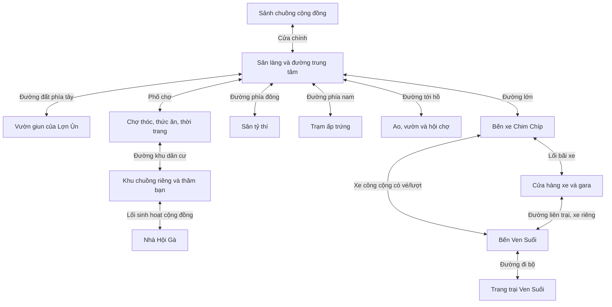

# Hypex — Thiết kế lại thế giới 3D, sảnh cộng đồng và bản đồ di chuyển

Ngày: 01/11/2026 · Bản thiết kế 1.1 · Trạng thái: đã triển khai R0–R4 và một phần R5 trên Go + Three.js (xem mục 14 và [TIEN_DO.md](TIEN_DO.md)); chưa đo FPS trên điện thoại thật.

**Cập nhật mỹ thuật 02/11/2026:** dùng [PLAN_GIAO_DIEN_BO_2.md](PLAN_GIAO_DIEN_BO_2.md) làm chuẩn mới cho camera đối chiếu, kiến trúc, vật liệu, nhân vật và HUD theo 11 ảnh bộ 2. Plan bộ 2 chưa được triển khai; trạng thái R0–R5 ở tài liệu này chỉ thuộc đợt làm thế giới trước. Phần mô tả code “cần thay đổi” tại mục 2.2 bên dưới là căn cứ lịch sử của đợt đó, không phải hiện trạng mới nhất.

Tài liệu này là đặc tả mới cho camera, sảnh, NPC, bản đồ, đường đi và chuyển khu. Khi có khác biệt về các phần đó, dùng tài liệu này thay cho thiết kế cũ trong PLAN.md bản 0.3. Các luật tài khoản, mana, giun, thóc, nhà, thời trang, xe, PK và Hội Gà vẫn theo [PLAN.md](PLAN.md), trừ những điều chỉnh về cách tiếp cận địa điểm được nêu rõ bên dưới.

## 1. Kết quả cần đạt

Người chơi vào một **chuồng gà cộng đồng rộng, có chủ chuồng ngồi trên bục ở đầu sảnh, nhiều ổ rơm và một số NPC đang sinh hoạt**. Góc đầu tiên có bố cục gần ảnh minh họa: nhìn từ phía cửa vào hướng tới bục, thấy nhiều hàng gà và chiều sâu của chuồng. Người chơi có thể xoay ngang, ngẩng/cúi, zoom và điều khiển gà đi trong không gian đó.

Ra khỏi cửa chính là sân làng và mạng đường đi. Vườn giun, chợ, bến xe, khu nhà, trạm ấp, sân PK và Nhà Hội là các địa điểm riêng ngoài chuồng. Bản đồ cho biết chúng ở đâu và đường tới đó; muốn đào, mua đồ hay lên xe thì phải đến nơi. Đây là cách tổ chức game xã hội có thế giới để khám phá theo định hướng người dùng muốn từ Play Together.

### Các quyết định từ yêu cầu mới

- Sảnh là không gian gặp gỡ có bố cục và sinh hoạt riêng, không đặt hàng loạt cổng tới chức năng quanh vách chuồng.
- Chủ chuồng ở trên bục phía cuối sảnh; thêm NPC thường trú để ít người online vẫn có sinh hoạt.
- Camera là phối cảnh 3D có thể điều khiển, kết hợp góc sinh hoạt rộng và góc đi theo nhân vật.
- Vườn giun, bến xe và các khu đất nằm ngoài chuồng, hiện trên bản đồ.
- Có bản đồ làng và bản đồ vùng/trang trại; đi bộ hoặc dùng phương tiện để đến nơi.
- Thế giới đủ đông người, có nhiều bản sao/phòng để phục vụ cộng đồng lớn.

### Thông số đề xuất, cần thử trước khi chốt

Sảnh 50 người chơi + 6–8 NPC; kích thước **chốt 32 × 42 đơn vị** sau bản dựng thử (40 × 52 nhìn từ góc sinh hoạt bị trống, gà và ổ quá nhỏ so với ảnh mẫu); camera mặc định 35–45° so với mặt đất; bản đồ làng có tuyến đi bộ 15–60 giây giữa các điểm chính. Đây là mục tiêu thiết kế, không phải sức chứa hoặc chất lượng hình ảnh đã đo được.

## 2. Căn cứ thiết kế và hiện trạng đã kiểm tra

### 2.1. Tài liệu tham khảo

| Tham khảo | Phần áp dụng |
| --- | --- |
| Ảnh sảnh chuồng do người dùng cung cấp | Bục cao ở cuối chuồng, chủ chuồng ngồi ổ, hàng ổ rơm, màu gỗ/đất ấm, camera từ cửa nhìn vào |
| Ảnh rạp cộng đồng người dùng gửi | Chiều sâu không gian đông avatar, trọng tâm phía trước, HUD đặt ở viền màn hình |
| Ảnh chụp Hypex hiện tại người dùng gửi | Đối chiếu góc nhìn cao, bảng tên lớn, bục còn trống và nhiều biển ra khu khác trong sảnh |
| [Thiền Online](https://www.thienonline.site/) | Cảnh chiếm màn hình, chạm sàn để đi, kéo thay đổi góc nhìn, zoom và không gian sinh hoạt chung |
| [Giới thiệu Play Together của HAEGIN](https://hub.playtogether.haegin.kr/homegame-guide/whats-the-play-together) | Thế giới xã hội: gặp bạn, khám phá, nhà riêng và hoạt động chung |
| [Downtown — hướng dẫn chính thức](https://help-playtogether.haegin.kr/hc/en-us/articles/30510511797401-Downtown) | Tham khảo cách một điểm giao thông trong khu trung tâm dẫn tới khu vực khác |

Đã đọc mã công khai `scene.js` của Thiền Online: có camera phối cảnh, biến góc ngang/góc đứng/khoảng cách, kéo đổi góc, chạm raycast chọn đích và thao tác zoom. Đây là bằng chứng về cách điều khiển trong mã; chưa kiểm thử trực tiếp trải nghiệm chạy của website trong lượt này. Các thông số camera của Hypex bên dưới là đề xuất riêng, không lấy nguyên giá trị từ trang mẫu.

Đã xem trực tiếp ảnh minh họa sảnh, vườn giun, bến xe trong project cùng ảnh người dùng gửi. Bộ ảnh là chuẩn tham chiếu mỹ thuật, không phải cảnh 3D có thể xoay trực tiếp. Cần dựng hình học, vật liệu và hoạt ảnh để giữ được cảm giác của ảnh ở nhiều góc nhìn.

### 2.2. Các điểm trong code cần thay đổi

| Hiện trạng đọc được | Hệ quả | Hướng sửa |
| --- | --- | --- |
| `client/js/world.js`: PerspectiveCamera FOV 50; vị trí camera cao tính cố định từ `camDist` | Zoom có nhưng góc nhìn vẫn cao; không có điều khiển pitch độc lập | Tách CameraController, có yaw/pitch/radius và các preset |
| `client/js/main.js`: kéo chỉ cập nhật `camTargetYaw`; wheel cập nhật khoảng cách | Chưa kéo lên/xuống để đổi góc đứng, chưa có chạm sàn để đi trong gameplay | Bộ xử lý thao tác thống nhất cho chuột/chạm/joystick |
| `World.show()` reset yaw về 0 mỗi lần chuyển khu | Đổi khu dễ mất hướng đang nhìn | Camera profile theo khu, giữ hướng hoặc chuyển mượt theo cửa đến |
| `server/world.go`: lobby có gate trực tiếp tới garden/market/arena/hatchery/station | Sảnh biến thành bảng chọn điểm đến | Một cửa chính ra `village`, các cổng khu nằm dọc đường ngoài làng |
| Lobby hiện có HalfX 12.4, HalfZ 9.6; NPC chủ đứng gần cửa | Không thể hiện hội trường lớn có chủ ở bục | Bố cục sảnh mới, chủ chuồng ngồi trên bục và NPC đón khách riêng |
| `World.placeItem()` tạo label cho mọi điểm tương tác | Nhiều biển chữ lơ lửng lớn che cảnh | Nhãn theo khoảng cách, điểm đang chọn và hạn mức cùng hiện |
| `Zone.Clamp()` chỉ kẹp tọa độ theo hình chữ nhật | Chưa mô tả đủ đường đi quanh đồ đạc và cửa | Walkable area, collider tĩnh và cạnh chuyển khu có hướng |
| `RoomCapacity = 25`, một public Room chứa nhiều zone | Tăng riêng sảnh lên 50 không chỉ là thêm ổ rơm | Tách giới hạn room và giới hạn zone; kiểm tra tải thật trước khi tăng |

Code đang dùng **Go + gorilla/websocket và Three.js JavaScript**, lưu JSON nguyên tử. Giữ nền này cho đợt làm lại thế giới. PostgreSQL/Redis/nhiều instance là công việc production riêng; không đưa việc chuyển sang React/Colyseus vào yêu cầu sửa giao diện.

Các kết quả test và tải trong [TIEN_DO.md](TIEN_DO.md) là báo cáo sẵn có của bản trước. Chúng chưa chứng minh sảnh mới có 50 gà mặc đồ, NPC, xe và camera mới chạy mượt; cần đo lại theo cảnh thực tế.

## 3. Ngôn ngữ hình ảnh

- Gà tròn, thân mềm, mào/mỏ rõ; giữ nhận diện ở khoảng cách vừa. Bộ mẫu có nhiều màu và quần áo; tránh phải đọc tên mới phân biệt được từng gà.
- Gỗ nâu ấm, nền đất có biến thiên màu và chi tiết nhỏ, rơm có sợi/khối mềm, ánh sáng vàng nhẹ và bóng tiếp xúc.
- Kích thước chuồng lớn nhưng vẫn có mốc tỷ lệ: máng nước ngang thân gà, ổ rơm vừa một gà, bậc thang thấp, cửa cao và rộng.
- Tạo chiều sâu bằng lớp tiền cảnh, hàng ổ, lối đi, bục và vách sau; không chỉ tăng diện tích nền trống.
- Mái/kèo có mặt trong để xoay camera vẫn thấy kiến trúc. Khi che nhân vật thì xử lý camera/ẩn vật cản có chọn lọc.
- Mỗi khu đất có hình dáng và vật mốc riêng: vườn có ụ đất/gốc cây; bến có đường và mái chờ; chợ có sạp; sân PK có khán đài; khu dân cư có nhiều cổng chuồng.
- Asset dùng GLB hoặc mô hình có hình khối đủ hoàn chỉnh. Có thể giữ primitive cho bản dựng thử bố cục; bản đạt mỹ thuật cần đối chiếu ảnh ở nhiều góc.

Ưu tiên hoàn thiện một góc sảnh với gà, ổ rơm, bục và ánh sáng trước, sau đó áp dụng bộ vật liệu/mô hình đó sang các khu còn lại. Không chỉ thay màu UI để xử lý vấn đề chiều sâu của cảnh.

## 4. Camera và điều khiển

### 4.1. Ba chế độ góc nhìn

| Chế độ | Khi dùng | Hành vi |
| --- | --- | --- |
| Góc sinh hoạt | Lần đầu vào sảnh, ngồi ổ hoặc bấm “Góc sảnh” | Từ cửa nhìn về bục, thấy nhiều hàng gà, phối cảnh rộng giống ảnh; có thể kéo xoay/zoom |
| Theo gà | Khi đi bộ, chạy hoặc ra ngoài | Theo nhân vật có độ trễ nhẹ, gà ở khoảng 55–65% chiều cao màn hình, nhìn được đường trước mặt |
| Ngồi xe | Khi lái hoặc làm hành khách | Theo xe và hướng chuyển động, nhìn thấy đường; hành khách có thể xoay ngắm xung quanh |

Khi từ góc sinh hoạt bắt đầu đi, camera chuyển sang theo gà trong khoảng 0,4–0,8 giây. Đi qua cửa không tự quay 180°. Nếu người chơi đang kéo camera thì không tự căn lại ngay; nút “Đặt lại góc” chỉ đổi camera, không dịch chuyển nhân vật.

### 4.2. Thông số thử

Quy ước pitch là góc nhìn xuống so với mặt đất: 0° nhìn ngang, 90° nhìn thẳng từ trên.

| Thông số | Đề xuất |
| --- | --- |
| Kiểu chiếu | Perspective |
| FOV dọc | 40–50°, khởi điểm 45°; kiểm tra riêng màn hình dọc |
| Pitch sinh hoạt | 35–45° |
| Pitch theo gà | 25–35° |
| Khoảng pitch người dùng điều chỉnh | 15–60° |
| Yaw | Xoay liên tục 360°, nội suy theo cung ngắn nhất |
| Khoảng cách theo gà | 7–18 đơn vị |
| Khoảng cách góc sảnh | 18–32 đơn vị, đủ thấy bục và hàng gà ở viewport mục tiêu |
| Điểm nhìn | Cao gần phần ngực/đầu gà, thêm khoảng nhìn trước theo hướng đi |
| Chuyển mượt | Theo thời gian delta; mức giảm chuyển động bỏ trôi và rung |

Khoảng cách phải hiệu chỉnh sau khi chốt chiều cao gà và kích thước chuồng. Không ép toàn bộ sảnh 40 × 52 vào mọi viewport; trên điện thoại ưu tiên gà của mình, lối đi và phần sân khấu thay vì thu nhỏ mọi thứ thành chấm.

### 4.3. Điều khiển PC và điện thoại

- PC: WASD/mũi tên di chuyển theo hướng camera; kéo nền cảnh để xoay cả ngang và đứng; wheel để zoom; E tương tác; M mở bản đồ.
- Click nhanh vào mặt đất hợp lệ: gà đi theo đường tới điểm đó. Kéo quá khoảng 6 px thì coi là xoay, không phát lệnh đi khi thả chuột; ngưỡng phải thử theo thiết bị.
- Click NPC/ổ rơm: nếu ở gần thì tương tác, nếu ở xa trong cùng khu thì đi tới vị trí tiếp cận trước. Không xuyên tường để đi thẳng tới mục tiêu.
- Mobile: joystick trái, kéo vùng cảnh bên phải để nhìn, hai ngón zoom, nút tương tác bên phải; chạm mặt đất có thể dùng khi không chạm joystick/HUD.
- Phân biệt pointer theo ID: một ngón giữ joystick, ngón còn lại xoay camera được đồng thời. Pinch không phát lệnh đi; nhả/đứt pointer phải giải phóng input.
- Nhập chat, mở bảng mua đồ hoặc bản đồ phải chặn input đi xuyên qua UI. Rời cửa sổ/tắt tab gửi trạng thái dừng phù hợp.
- Nhấn WASD/joystick hủy đường đi bằng click. MVP chỉ click-to-walk trong khu hiện tại; chọn địa điểm trên bản đồ chỉ chỉ đường, chưa tự chạy xuyên nhiều bản đồ.

### 4.4. Camera có vật cản

- Camera cast từ điểm nhìn tới vị trí mong muốn; gặp tường/cột thì thu bán kính, trở lại dần khi hết cản.
- Ẩn hoặc làm mờ phần mái/vách đang che gà; không làm mất toàn bộ công trình khi chỉ một góc mái cản.
- Gần tường không để camera lọt ra ngoài nhìn thấy lưng mesh rỗng; vùng đứng ngoài chuồng không thấy xuyên toàn bộ nội thất.
- Ngồi ổ hay lên xe giữ điểm nhìn ổn định, không đặt camera vào đầu gà phía sau.

## 5. Sảnh chuồng gà rộng và có sinh hoạt

### 5.1. Bố cục đề xuất

Kích thước đã chốt: rộng 32, sâu 42 đơn vị (bản thử 40 × 52 quá thưa); gà trưởng thành cao khoảng 1,35 đơn vị. Cửa vào ở phía nam, bục chủ ở phía bắc. Trục chính thông suốt từ cửa tới bục.

| Thành phần | Quy mô/bố trí |
| --- | --- |
| Bục chủ chuồng | Rộng khoảng 10, sâu 4, cao 1,2 đơn vị; bậc hai bên, ổ lớn ở giữa |
| Gà Cụ Cục, chủ chuồng | Ngồi trên ổ ở bục, nhìn xuống sảnh; quay đầu/chào khi người tới gần |
| Ổ dành cho người chơi | 40 ổ, 5 hàng × 8, cách nhau 2,7 × 4,4; mỗi hàng chia hai cụm 4 ổ bằng lối giữa rộng 6,4 |
| Lối đi | Trục giữa rộng khoảng 4 đơn vị; lối bên và khoảng giữa hàng đủ hai gà tránh nhau |
| Chỗ sinh hoạt NPC | 4–6 ổ/điểm đứng riêng ở cạnh sảnh, không chiếm số chỗ người chơi |
| Khu đứng/tụ tập | Phía cửa và hai bên, đủ chỗ cho người không ngồi |
| Máng ăn/nước | Dọc hai vách, không chặn lối đi hoặc tầm nhìn sân khấu |
| Bảng tin | Một bảng nhỏ gần lối vào, không có hàng loạt biển dịch chuyển |
| Cửa chính | Một lối rộng ra sân làng; hai lá cửa hoặc cửa mở cố định, tránh nghẽn |

Số ổ không phải sức chứa mạng: 50 người có thể vừa ngồi vừa đứng. Có thể mở các cụm ổ sau khi benchmark 50 người, nhưng không nhân số NPC cho đủ con số online.

```text
                  PHÍA BẮC / CUỐI SẢNH
         ┌───────────────────────────────────┐
         │       BỤC + Ổ CHỦ CHUỒNG          │
         │          GÀ CỤ CỤC NGỒI           │
         │    bậc trái             bậc phải  │
         │                                   │
         │  ○ ○ ○ ○     LỐI GIỮA    ○ ○ ○ ○ │
 MÁNG ĂN │  ○ ○ ○ ○                 ○ ○ ○ ○ │ MÁNG NƯỚC
         │  ○ ○ ○ ○                 ○ ○ ○ ○ │
         │  ○ ○ ○ ○                 ○ ○ ○ ○ │
         │  ○ ○ ○ ○                 ○ ○ ○ ○ │
         │                                   │
         │ NPC / ổ phụ           NPC / ổ phụ │
         │ Bảng tin     VÙNG XUẤT HIỆN        │
         └──────────── CỬA CHÍNH ─────────────┘
                         ↓
                  SÂN LÀNG NGOÀI TRỜI
```

### 5.2. Chủ chuồng và NPC thường trú

| NPC | Vị trí và việc làm |
| --- | --- |
| Gà Cụ Cục | Ngồi trên bục, giao nhiệm vụ chính, chào người tới, kể chuyện trại |
| Gà Đón Khách | Gần cửa, hướng dẫn camera, ổ ngồi, bản đồ và đường ra ngoài |
| Gà Quét Sân | Đi theo tuyến ngắn bên vách, quét rơm; cho việc cứu đói nếu cần |
| Gà Mê Ngủ | Nằm ở ổ phụ, đổi tư thế/ngáp theo chu kỳ |
| Hai Gà Hàng Xóm | Ngồi trò chuyện bằng biểu cảm, đôi lúc đứng đi tới máng nước |
| Chim Đưa Thư | Đậu gần bảng tin hoặc cửa sổ, hướng dẫn thư/bạn bè |

Mặc định 7 NPC; tùy cấu hình có thể 6–8. NPC chức năng ở ngoài như Lợn Ủn, Bò Mộc, trọng tài, bán vé và Vịt Bông vẫn ở đúng khu đất. Gà Cụ Cục không đồng thời xuất hiện cạnh cửa và trên bục; việc cứu đói giữ nguyên luật thưởng, chỉ đổi người tiếp nhận hoặc điểm tiếp cận.

- NPC có vòng trạng thái chờ → đi tới điểm → làm động tác → nghỉ; có lệch nhịp để không cùng nhún một lúc.
- Tên NPC có dấu nhận biết; số “người đang chơi” chỉ tính tài khoản thật đang ở khu. Bot load test không được trộn vào số online production.
- NPC thường trú không tự gửi chat giả như người thật, không giữ giun hiếm hoặc thu phần thưởng của người chơi.
- Đường đi NPC tránh cửa/lối giữa. NPC là trang trí có tương tác nhẹ; không đẩy hoặc chắn nhân vật.
- Lịch hoạt ảnh/đường đi có seed và mốc thời gian từ máy chủ; client mô phỏng phần nhìn. NPC có phần thưởng/đối thoại vẫn kiểm tra quyền và khoảng cách ở server.

### 5.3. Tương tác với ổ và bục

- Chọn ổ trống → đi tới điểm tiếp cận → máy chủ giữ chỗ → ngồi. E/joystick để đứng dậy. Một ổ chỉ một người.
- Ghế giữ ngắn khi đi tới, hết hạn nếu không đến; mất mạng giữ trong cửa sổ reconnect rồi giải phóng.
- Ngồi xoay camera và chat bình thường; đứng lên trước khi đi/đào/lái xe. Khi đói vẫn có thể ngồi và mở túi ăn.
- Chủ chuồng có pose ngồi trên bục, không phải model đặt ở y=0 xuyên mặt sàn. Tương tác từ điểm tiếp khách cạnh bậc trong phạm vi cho phép; không cần nhảy lên đầu chủ.
- Mỗi điểm spawn có vùng trống, rải người mới ở phía cửa. Không để NPC hoặc người ngồi chiếm toàn bộ lối vào.

## 6. Bản đồ thế giới và các khu đất

### 6.1. Ba khái niệm cần tách rõ

| Khái niệm | Ví dụ | Ý nghĩa |
| --- | --- | --- |
| Vùng/trang trại | Hypex, Ven Suối | Bản đồ địa lý lớn, có nội dung và tuyến giao thông riêng |
| Khu/zone | Sảnh, sân làng, vườn giun, bến xe | Không gian có lối vào, đường đi, NPC và hoạt động riêng |
| Kênh cộng đồng | Hypex 01, Hypex 02 | Bản sao phục vụ đông người, cùng địa lý và luật |

Đổi kênh không phải di chuyển địa lý. Sang vườn phải đi tới vườn; đổi Hypex 01 sang 02 chỉ đổi nhóm người đang gặp, không reset vị trí hoạt động/cooldown. Tên chuồng vẫn dùng cho nội thất; tên kênh ở HUD rõ ràng để không gọi mọi vùng ngoài trời là “trong chuồng”.

### 6.2. Sơ đồ tuyến đi

Các đường dưới đây là kết nối vật lý hoặc tuyến giao thông có thể dùng, không phải nút teleport từ sảnh.



### 6.3. Vai trò từng bản đồ

| Khu | Nội dung chính | Nhận diện nhìn từ đường |
| --- | --- | --- |
| Sảnh | Tụ tập, ngồi ổ, gặp chủ chuồng, hướng dẫn | Chuồng gỗ lớn, mái/kèo cao, cửa rộng |
| Sân làng | Ngã đường, định hướng, gặp bạn, điểm hẹn | Cây lớn, cột chỉ hướng nhỏ, lối đất nối khu |
| Vườn giun | Đào nhiều tiểu vùng, khoe giun, gặp Lợn Ủn | Hàng rào thấp, ụ đất, gốc cây, dụng cụ |
| Chợ | Bán giun, mua thức ăn, thử/mua váy vest kính | Sạp mái vải, quầy riêng, gà bán hàng |
| Sân PK | Mời đấu, xem, hoạt ảnh thắng/KO | Sân đất trống, hàng ghế/ổ quanh rìa |
| Khu nhà | Tới cổng nhà mình/bạn, trang trí và mời chơi | Đường nhỏ có nhiều chuồng và số nhà |
| Trạm ấp | Nhận trứng, ấp, chăm NPC đi theo | Nhà ấm, ổ ấp và Vịt Bông |
| Nhà Hội | Tụ tập thành viên, công trình chung | Cổng hội, sân và cờ hội |
| Ao/vườn/hội chợ | Đi dạo, khám phá, sự kiện; tính năng chưa làm được gắn trạng thái rõ | Hồ, cây, lều hội chợ |
| Bến xe | Chờ xe, xem chuyến và giá, dùng lượt free | Đường xe vào, nhà chờ, quầy vé, xe thật xuất hiện |
| Cửa hàng xe | Xem/mua xe, lấy xe, mời bạn lên, cất xe | Xe trưng bày, gara, vạch đỗ |
| Ven Suối | Khám phá xa, giun đặc sản, bến về | Suối, cầu, bãi bồi, màu cây/nền riêng |

### 6.4. Khoảng cách và cảm giác di chuyển

- Cửa sảnh → điểm giữa sân làng: 5–10 giây đi bộ.
- Sân làng → chợ/vườn: khoảng 15–30 giây theo đường.
- Sân làng → bến/khu dân cư: khoảng 30–45 giây.
- Các điểm xa trong cùng vùng: 45–60 giây đi bộ; xe có lợi ích rõ nhưng người chưa có xe vẫn đến được.
- Không đặt thời gian đi dài chỉ để tiêu mana. Đo thời gian khi hướng dẫn; bữa ăn đầu phải mua được trước khi người mới bị kiệt sức.
- Dùng khúc cua, cầu, cây và đường mở rộng làm mốc; mỗi 10–15 giây nên có một tín hiệu đường đi hữu ích.

Đây là ngân sách thời gian, không suy từ số đơn vị cứng. Khi dựng graybox phải chạy với tốc độ đi thật đang dùng ở server và điều chỉnh chiều dài đường.

### 6.5. Cảnh liền mạch trong trải nghiệm, chia khu để tải

Sân làng là bản đồ ngoài trời có đường dẫn tới cổng các khu. Người chơi thấy đường đi và ngoại cảnh khu phía trước. Khi đi qua ranh giới rõ như cổng, cầu hoặc đường khuất cây, máy chủ chuyển zone và client tải/phát cảnh đích.

- Tải trước asset khu liền kề khi tới gần; chỉ giữ khu hiện tại và phần cần thiết của các khu gần, thay cho dựng mọi khu từ đầu.
- Lối ra/lối vào đối xứng, spawn ngay sau cửa tương ứng và hướng mặt theo đường đi; trở lại làng xuất hiện đúng cổng vừa rời.
- Không đưa người từ bất kỳ khu nào về cửa sảnh chỉ vì đi qua gate mặc định.
- Không có viền vuông/hàng rào bao mọi cảnh một cách giống nhau. Tường/rào theo thiết kế thực; dùng địa hình và vật mốc định hình từng khu.
- Chuyển cảnh có thể mất thời gian tải ngắn; hiển thị tiến trình, giữ trạng thái nguồn cho tới khi đích sẵn sàng và không trừ tài sản hai lần.

## 7. Bản đồ tương tác và dẫn đường

### 7.1. Minimap

Góc trên phải có minimap nhỏ: vị trí/hướng gà, lối ra, mục tiêu hiện chọn, NPC quan trọng và bạn bè đồng ý chia sẻ vị trí. Trong sảnh hiển thị sơ đồ ổ/bục/cửa; ra ngoài chuyển sang lớp bản đồ làng. Nhấn minimap hoặc M mở bản đồ lớn.

### 7.2. Bản đồ lớn

- Bản đồ 2D có hình dạng đường, công trình, nước và khu đất, dùng biểu tượng gà/giun/xe/nhà dễ hiểu.
- Hai lớp: “Trại Hypex” xem chi tiết địa điểm; “Các trang trại” xem Hypex, Ven Suối và tuyến nối.
- Trạng thái địa điểm: đang ở, đã mở, khóa cấp, chưa phát hành, có nhiệm vụ. Không bán vé hoặc cho nhận nhiệm vụ tới khu chưa tồn tại.
- Chọn vườn giun: hiện tên, hoạt động, NPC, điều kiện, thời gian đi bộ ước tính và nút **“Đặt chỉ đường”**.
- Đường hướng dẫn vẽ từ vị trí hiện tại tới cửa ra và qua các khu theo đúng mạng đường. Trong sảnh, bước đầu luôn là tới cửa chính.
- Dẫn đường gồm vạch/chấm dưới đất, mũi tên nhỏ ở rìa màn hình và khoảng cách tới điểm tiếp theo. Không dùng cột chữ lớn che toàn cảnh.
- Chọn vùng xa: chỉ tới bến hoặc cổng đường liên trại. Chỉ đặt chuyến và trả vé ở bến; mở bản đồ không tự mua vé.
- Đi lạc hoặc đổi hướng: tính lại tuyến; vùng chưa đủ cấp hoặc xe không đi được thì giải thích và đề xuất đường đi bộ hợp lệ.
- Khi bản đồ mở, nhân vật dừng để tránh đi ngoài ý muốn. Mana vẫn tuân theo thời gian online và có cảnh báo đói trên bản đồ.

### 7.3. Đi tới bạn và nhà riêng

- “Tìm bạn” chỉ hiện vị trí nếu được chia sẻ. Cùng vùng thì đặt chỉ đường tới khu của bạn; khác kênh có thể đổi kênh tại vị trí hiện tại nếu còn chỗ, sau đó đi tiếp.
- Bạn ở vùng xa: chỉ đường đến bến và tuyến tương ứng, không miễn vé bằng lời mời bạn bè.
- Nhà riêng: tới khu dân cư trước, dùng bảng số nhà/danh bạ để chọn cổng và đi vào. Không thể mở danh sách nhà rồi dịch chuyển trực tiếp từ sảnh.
- Lời mời là quyền vào và điểm hẹn, không tự chuyển vị trí. Chặn/quyền nhà được kiểm tra lại lúc tới cửa.
- Ngoại lệ duy nhất về quay về nhanh là “Về sảnh an toàn” đã có để phục hồi đói/kẹt; đưa vào menu hỗ trợ với xác nhận. Không dùng nó làm thanh điều hướng thường trực tới mọi nơi.

## 8. Giao diện phủ trên cảnh 3D

| Vị trí màn hình | Thành phần |
| --- | --- |
| Trên trái | Avatar nhỏ, tên/cấp, mana; XP thu gọn |
| Trên giữa | Tên khu, kênh và số người thật đang ở khu |
| Trên phải | Thóc và minimap; cài đặt trong menu |
| Viền phải | Túi, bạn bè, nhiệm vụ, tủ đồ; mục ít dùng gom trong menu |
| Dưới trái | Chat thu gọn trên PC; joystick trên mobile, chat mở riêng để không đè |
| Dưới giữa | Một mục tiêu nhiệm vụ hoặc thanh chat tùy chế độ |
| Dưới phải | Nút tương tác theo ngữ cảnh, biểu cảm, lên/xuống/đứng dậy |

- Khi không mở bảng, mục tiêu là khoảng 80% diện tích còn xem được cảnh; kiểm tra bằng ảnh trên từng cỡ màn hình, không coi là tỷ lệ đã đạt.
- Bảng mua đồ/NPC mở khi đã đến đúng nơi. Tủ đồ, túi, bạn bè và bản đồ là tiện ích cá nhân có thể mở ở mọi nơi theo luật trận.
- Hạn chế label: chỉ hiện tên bản thân, người gần đang tương tác và NPC được chọn; người xa dùng dấu nhỏ hoặc ẩn. Tối đa khoảng 8 nhãn tên ưu tiên cùng lúc, 1 gợi ý tương tác chính.
- Nhãn đặt theo kích thước màn hình có giới hạn khoảng 12–16 px cho tên, không phóng to liên tục khi đến gần; ẩn khi bị tường che. Bảng tên thật trên công trình là mesh/texture theo tỷ lệ thế giới.
- “Chuồng gà Hypex” là bảng hiệu gắn kiến trúc hoặc tiêu đề HUD ngắn khi vừa vào, không phải banner lớn lơ lửng giữa sảnh.
- Khi sảnh đông có thể thu gọn tên/bong bóng/hiệu ứng, nhưng không ẩn người đang tương tác hoặc làm biến mất bạn ngồi ngay cạnh.
- Cỡ chạm mobile khoảng 44–48 px; tránh tai thỏ, bàn phím và cạnh dưới. Có nút ẩn HUD để ngắm/chụp ảnh.

## 9. Nối gameplay hiện có vào địa điểm thực

| Hệ thống | Đến đâu và thực hiện thế nào |
| --- | --- |
| Đào/khoe giun | Tới vườn, đi tới ụ hợp lệ, đào rồi nâng giun khoe trong khu |
| Bán giun/mua ăn | Tới sạp chợ, đứng trong khoảng tương tác; món đã mua vẫn ăn từ túi |
| Thời trang | Đến cửa hàng để mua/thử hàng mới; phối đồ đã sở hữu trong tủ cá nhân |
| PK | Mời tại sảnh/ngoài đường được, nhưng xác nhận điểm hẹn ở sân PK; cả hai tới sân rồi bắt đầu, không tự teleport khi nhận lời |
| Nhà riêng | Đi tới khu dân cư, cổng nhà kiểm tra quyền rồi vào phòng nhà |
| Ấp trứng | Tới Trạm ấp để bắt đầu/nhận; thư thông báo nở ở mọi nơi, không tự kéo người về trạm |
| Hội Gà | Menu quản lý/chat hội ở mọi nơi; bước vào Nhà Hội từ khu dân cư để sinh hoạt trong cảnh |
| Xe riêng | Tới gara/điểm đỗ, lấy xe, mời khách; lái trên đường cho phép |
| Xe buýt | Tới bến, xem tuyến và lượt free, giữ ghế/trả vé, chờ xe và tới bến đích |
| Mana/cứu đói | Giữ giá và luật hiện có; cứu đói tại sảnh, hồi về an toàn khi cần |

PK hẹn tại sân là thay đổi luồng của bản mới: lời mời có thời gian di chuyển riêng, đề xuất 120 giây, được hủy; không dùng timeout 20 giây dành cho phản hồi lời mời để buộc người chạy kịp. Khi cả hai tới sân mới mở ready/countdown; chưa tới thì không bắt đầu hoặc cấp thưởng.

Các mức vé 3 lượt/ngày và giá theo tuyến trong plan kinh tế giữ nguyên dưới dạng cấu hình. Đi từ sảnh đến chợ/vườn trong Hypex không dùng lượt xe miễn phí. Phương tiện có lợi ích về tốc độ và chở bạn, không biến thành cách bỏ qua khóa cấp/quyền nhà.

## 10. Sức chứa, đồng bộ và đông gà

### 10.1. Mục tiêu và cách mở rộng

| Đơn vị | Mục tiêu đề xuất |
| --- | --- |
| Sảnh | 50 người thật + 6–8 NPC thường trú |
| Khu ngoài trời thông thường | 25 người/khu trước, tăng theo kết quả tải |
| Nhà riêng | 8 người như plan trước |
| Toàn hệ thống | Giữ mục tiêu 1.000 online đồng thời trên nhiều kênh |
| Mức thử tăng thêm | 75/100 người trong một sảnh chỉ là stress test, chưa công bố hỗ trợ |

Không lấy việc có 50 ổ rơm hoặc 1.000 bot socket làm chứng cứ render 50 gà mượt. Cần cả tải máy chủ, băng thông và thiết bị thật với cùng kịch bản.

### 10.2. Chuyển từ room hiện tại

Hiện room công cộng gắn một vùng và chứa nhiều zone, tổng 25 người. Đợt sửa đầu **giữ mô hình room nhiều zone** để giảm rủi ro thay toàn bộ multiplayer; bổ sung `roomCapacity` và `zoneCapacity` tách biệt. Đề xuất room 100 chỗ toàn vùng trong một kênh, lobby 50, các khu khác 25; con số tổng là cấu hình thử và phải đủ chứa tổng người đang phân bố trong kênh.

- Join mới cần đồng thời còn chỗ ở room và sảnh; chuyển khu trong cùng room chỉ cần còn chỗ tại khu đích.
- Khi vườn đầy: giữ người ở sân làng/điểm chờ ngoài cổng, báo số chỗ và hàng đợi. Có thể chọn kênh khác ngay tại khu hiện tại rồi tiếp tục qua cửa; không nhảy thẳng vào vườn.
- Nhóm/xe giữ đủ số chỗ tại khu đích trước khi rời nguồn. Không chuyển một phần nhóm rồi bỏ khách còn lại.
- Khi về sảnh lúc sảnh đầy: xếp hàng hoặc tìm kênh có sảnh còn chỗ; lối hồi phục an toàn phải hoàn tất được mà không vượt cap.
- Snapshot chỉ gửi người/entities thuộc zone và phạm vi quan tâm. Số toàn kênh khác số trong khu, HUD phải ghi rõ.
- Nếu room tổng gây phân bố xấu ở quy mô lớn, bước sau có thể tách room theo zone; chỉ làm khi có số liệu và kế hoạch migration session/party/chat. Không coi đó là điều kiện để bắt đầu chỉnh camera/art.

## 11. Kế hoạch kỹ thuật trên repository hiện tại

| File/module | Thay đổi dự kiến |
| --- | --- |
| `client/js/world.js` | Tách camera khỏi dựng cảnh, profile theo zone, load/unload khu, va chạm camera, label theo khoảng cách |
| `client/js/camera.js` mới | Yaw/pitch/radius, preset sảnh/theo gà/xe, chuyển mượt, giảm chuyển động |
| `client/js/input.js` mới | Phân biệt tap/drag/pinch/joystick, chặn input khi mở UI |
| `client/js/map.js` mới | Minimap, bản đồ làng/vùng, chọn POI và dẫn đường |
| `client/js/navigation.js` mới | Click-to-walk nội khu, tuyến qua cổng, hủy/replan khi người tự điều khiển |
| `client/js/models.js` | Bộ gà/ổ/bục/vách được làm lại theo ảnh, pose ngồi và quần áo tương thích |
| `client/js/main.js` | Điều phối module, đổi camera theo state, nhận scene/zone/seat/route events |
| `client/js/panels.js`, `social.js`, `v11.js` | Chuyển nút đi thẳng thành đặt chỉ đường; shop/vé/nhà/PK cần vị trí hợp lệ |
| `client/index.html`, `client/css/style.css` | HUD viền, minimap, bảng map, bớt label/banner lớn |
| `server/world.go` | `village`, mạng cổng hai chiều, bounds/walkable/collision, điểm đến theo cửa và POI |
| `server/actions.go` | Xác thực đường vào khu, ghế ngồi, điều kiện tương tác, không cho client tùy chọn zone |
| `server/room.go`, `hub.go`, `config.go` | Cap tổng/khu, hàng đợi/chỗ giữ, NPC state, snapshot/phạm vi quan tâm |
| `server/pk.go`, `home_actions.go`, `v11_room.go` | Điểm hẹn PK, cổng nhà, chuyến xe nối topology mới |

### 11.1. Hợp đồng dữ liệu bản đồ

- `Region`: ID vùng, tên, danh sách zone, tuyến giao thông, điều kiện mở.
- `Zone`: ID, tên, walkable polygons hoặc grid, obstacles, spawn theo cửa, camera profile, cap, asset manifest.
- `Portal`: ID, zone nguồn/đích, vùng kích hoạt ở nguồn, arrival transform ở đích, phương tiện được phép và điều kiện.
- `POI`: ID, vị trí thật, biểu tượng minimap, loại chức năng, zone và điểm tiếp cận.
- `Seat`: ID, transform ngồi, approach point, owner/occupant, lease expiry.
- `AmbientNPC`: ID, vai trò, route/pose, seed/mốc thời gian; NPC không là player.
- `SceneManifest`: asset/version/bounds/occluders, tải theo zone, dùng cùng hệ tọa độ với dữ liệu server.

Một nguồn dữ liệu topology phải dùng cho kiểm tra server và chỉ đường client; không duy trì riêng hai bảng tên cổng rồi dễ dẫn sai đường. Bounds, obstacle và bậc có cao độ được biểu diễn 2.5D; kiểm tra đi trên bậc nhưng không bắt buộc thêm engine vật lý nặng cho cả game.

### 11.2. Di chuyển và an toàn trạng thái

- WASD/joystick vẫn gửi ý định, server tính vị trí. Click-to-walk gửi đích thuộc vùng đi được; server xác thực đường hoặc kiểm tra từng bước input qua obstacle, không tin client tự gửi vị trí đã tới.
- `go` phải xác thực đang gần đúng portal, cạnh nối hợp lệ, cap/quyền, và trạng thái PK/xe. Không chấp nhận tên zone bất kỳ chỉ vì có trong catalog.
- Chuyển khu: reserve → khóa input → bàn giao → xác nhận snapshot đích → giải phóng nguồn; thất bại trở về điểm an toàn phía nguồn, không làm mất tài sản.
- Đi ngược qua cửa dùng đúng `arrivalPortalId`, không gọi `freeSpawn()` chung cho toàn zone rồi xuất hiện sai đầu bản đồ.
- Vị trí NPC/bục cần hỗ trợ chiều cao hiển thị ổn định; chuyển NPC từ sàn lên bục không được để animation nhún ghi đè y về gần 0.
- Đổi kênh, scene hoặc reconnect không đổi mana, phần thưởng, vé, giun và quyền sở hữu.
- Client/server thống nhất phiên bản topology; khi khác phiên bản yêu cầu tải lại manifest hoặc nối lại có thông báo, không cho người đi theo collision cũ.

### 11.3. Dữ liệu cũ và hồi quy

Giữ nguyên ID tài khoản, ví, nhà, vật phẩm và các zone có thể tái dùng. Thêm `village` và portal mới bằng version migration. Vị trí lưu từ bản cũ không còn hợp lệ được đặt tại điểm an toàn gần nhất hoặc sảnh theo luật bắt đầu phiên. Gate ID cũ bị loại phải từ chối rõ ràng, không dẫn nhầm.

Hướng dẫn/nhiệm vụ dùng mốc ý nghĩa như “tới vườn”, không phụ thuộc biển `ra_vuon` cũ. Cập nhật các test đang đi trực tiếp từ lobby tới garden/market; không xóa test để che hồi quy. Chụp ảnh và kiểm tra chức năng hiện có sau khi thay cảnh/đường đi.

## 12. Hiệu năng và kiểm thử nghiệm thu

### 12.1. Kịch bản hình ảnh

So sánh cùng viewport, góc và khoảng cách với ảnh sảnh tham khảo; chụp ít nhất: từ cửa hướng bục, ngang hàng ổ, cạnh máng nước, phía bục nhìn ra cửa, góc đi theo gà ngoài làng, bản đồ mở và cảnh bến xe. Đánh giá bố cục, tỷ lệ gà, vật liệu, chiều sâu, label và hoạt ảnh; không chỉ kiểm tra trang đã tải.

### 12.2. Các điều kiện phải đạt

| Mã | Điều kiện nghiệm thu |
| --- | --- |
| A01 | Phiên mới vào sảnh, thấy chủ ngồi trên bục, ít nhất 6 NPC, nhiều hàng ổ và cửa ra làng |
| A02 | Kéo xoay đủ 360°, chỉnh góc đứng và zoom; đi theo gà, không nhảy góc đột ngột qua cửa |
| A03 | Click sàn đi quanh vật cản; drag/pinch/click UI không khiến gà đi nhầm |
| A04 | Từ sảnh không có gate trực tiếp garden/market/station; phải ra sân làng và đến đúng cổng |
| A05 | Map có làng/vùng, vị trí thật và tuyến đúng; chọn POI không dịch chuyển hoặc trừ vé |
| A06 | Vào/ra khu đứng ở đúng phía cửa, giữ hướng hợp lý; cổng sai/khóa/đầy có phản hồi |
| A07 | Hai người tranh ổ/ghế cuối chỉ một người thành công, reconnect không nhân chỗ |
| A08 | Sảnh 50 người mặc đồ + 6–8 NPC vẫn phân biệt được người, lối đi, bục; nhãn không phủ kín cảnh |
| A09 | Trên mobile tham chiếu, FPS ≥30 trong ít nhất 95% phiên 10 phút ở cấu hình thấp; desktop mục tiêu 60 FPS trung bình |
| A10 | Test cap/queue/group transfer khi chuyển khu và đổi kênh; không nhân thóc/giun/vé hoặc reset đói |
| A11 | Đi bộ tới bến rồi xe chở nhóm tới Ven Suối; hết lượt free trả đúng vé; lỗi chuyến hoàn đúng luật |
| A12 | Túi/thời trang/nhà/PK/ấp/Hội Gà vẫn hoạt động qua lối tiếp cận mới |

Chọn rõ ít nhất một Android tầm trung, một iPhone và một desktop tham chiếu trước khi dùng A09 làm lời hứa. Đo 25 → 50 → 75 người trong cùng sảnh, có hoạt động di chuyển/chat/ngồi/khoe; test 75/100 phục vụ tìm giới hạn. Nếu 50 không đạt thì tối ưu asset, label, cập nhật NPC và render trước khi hạ mục tiêu với chủ dự án.

Mô hình tải tổng 1.000 người phải phân bố cả khu, đồng thời có tình huống tụ 50 người tại một sảnh. Đo CPU/tick/bandwidth/memory và frame time client riêng. Chạy soak trên máy không ngủ; kiểm tra tải/giải phóng cảnh lặp để phát hiện rò bộ nhớ GPU.

## 13. Lộ trình sửa theo từng bước có thể xem được

Ước lượng sơ bộ **5–9 tuần** cho đợt làm lại thế giới này, với 2 lập trình viên quen codebase và 1 người làm 3D, có QA hỗ trợ. Không bao gồm chuyển toàn bộ hạ tầng production. Đây là dự toán thay đổi trên bản đã có, không cộng máy móc với lịch xây từ đầu trong PLAN.md.

| Bước | Thời gian đề xuất | Kết quả cụ thể |
| --- | --- | --- |
| R0 — Chốt tỷ lệ bằng bản dựng thử | 0,5–1 tuần | Sảnh 40 × 52, bục, 40 ổ, avatar đúng tỷ lệ; góc từ cửa và góc theo gà để đối chiếu ảnh |
| R1 — Camera và điều khiển | 0,5–1 tuần | Yaw/pitch/zoom, tap-to-walk, chống xuyên tường, mobile hai ngón, input UI đúng |
| R2 — Sảnh có sinh hoạt | 1–2 tuần | Chủ ngồi bục, 6–8 NPC, ổ ngồi thật, mỹ thuật/ánh sáng mẫu hoàn chỉnh |
| R3 — Làng và các khu | 1–1,5 tuần | Cửa sảnh → village → vườn/chợ/sân PK/bến; đường, portal hai chiều và spawn đúng |
| R4 — Bản đồ, xe và gameplay | 1–1,5 tuần | Minimap/map, chỉ đường, khu nhà/ấp/Hội, xe liên vùng theo lộ trình thật |
| R5 — Đông người và hồi quy | 1–2 tuần | HUD gọn, benchmark 50 gà, kiểm tra điện thoại, migration/test luồng cũ và báo cáo |

Tổng khoảng là 5–9 tuần nếu thực hiện tuần tự theo bảng; có thể song song asset và camera, nhưng thời gian phụ thuộc số model cần làm lại và lỗi phát hiện khi playtest. Không coi asset hoàn thành chỉ vì đã có 11 ảnh tĩnh.

**Lát cắt ưu tiên:** trước hết làm camera + một sảnh đẹp có chủ trên bục, 6 NPC và ổ ngồi. Sau đó nối một tuyến hoàn chỉnh **sảnh → cửa → sân làng → vườn giun → chợ → trở về**, có map chỉ đường. Dùng tuyến này để xác minh đúng cảm giác người dùng muốn trước khi nhân rộng toàn bộ vùng.

## 14. Checklist giao việc cho đợt sửa

- [x] Bố cục sảnh đối chiếu được với ảnh, chủ trên bục và lối đi rõ (ảnh chụp góc từ cửa, cạnh bục, ngồi ổ; sảnh 50 gà).
- [x] Camera kéo được ngang/đứng, zoom và theo nhân vật; đã thử bằng sự kiện chuột thật trong Chromium. Hai ngón trên điện thoại mới kiểm bằng code, chưa thử trên máy thật.
- [x] NPC có hoạt động (ngủ, quét sân, đi uống nước, trò chuyện, chào khách, chim đưa thư), nhường ổ khi người chơi lại gần; không tính vào số người chơi.
- [x] Có ngồi ổ, đứng dậy và chỗ được đồng bộ qua máy chủ.
- [x] Xóa cách đặt hàng loạt gate chức năng trong sảnh, thay bằng cửa ra village. Bản 01/11 tối: bỏ hẳn chuyển khu, mỗi trại là một bản đồ liền (mục 6.5 thay bằng thiết kế liền mạch theo yêu cầu người dùng).
- [x] Tạo đường ngoài trời và địa điểm riêng đủ khác biệt (vườn, chợ, sân PK, trạm ấp, ao, xóm, bến, gara, Ven Suối).
- [x] Map/minimap chỉ đường theo topology thật, tuyến trong làng bám đường đất; không teleport khi click địa điểm.
- [x] Nhà/bạn/Nhà Hội chỉ vào từ Xóm Rơm Vàng (máy chủ kiểm tra); lời mời ở xa thành chỉ đường. PK cần cả hai đứng ở sân tỷ thí.
- [x] HUD/label: nhãn giữ cỡ chữ ~14 px trên màn hình, tối đa 8 nhãn, nhãn NPC chỉ hiện khi lại gần.
- [ ] Benchmark cảnh đông trên thiết bị thật (A08/A09). Đã đo draw call: sảnh trống 450, sảnh 50 gà khoảng 1.370; cần đo FPS trên Android/iPhone tham chiếu.
- [x] README/TIEN_DO cập nhật kết quả thực tế.

## 15. Bộ ảnh dùng khi dựng từng khu

Xem toàn bộ tại [bộ ảnh minh họa](assets/illustrations/README.md).

| Ảnh | Khu sử dụng |
| --- | --- |
| 01 — Sảnh nông trại gà tối giản | Bố cục chủ chuồng, ổ rơm, máng và góc sinh hoạt |
| 02 — Chợ thóc gà vàng mộc mạc | Khu chợ riêng ngoài làng |
| 03 — Vườn giun của đàn gà | Bãi đào và hoạt động khoe giun |
| 04 — Đấu trường gà trên sân đất | Sân PK riêng |
| 05 — Khu nhà bạn bè | Đường khu dân cư và cổng nhà |
| 06 — Trạm ấp trứng gà | Khu ấp trứng |
| 07 — Sân họp gà mộc mạc | Nhà Hội và sân sinh hoạt |
| 08 — Ao, vườn và hội chợ gà | Khu dạo chơi/sự kiện |
| 09 — Bến xe Chim Chíp giữa đồng quê | Bến và quầy vé ngoài trời |
| 10 — Cửa hàng xe và điểm đỗ gà | Gara và ghế chở bạn |
| 11 — Trang trại gà ven suối mộc mạc | Vùng xa, cảnh quan và bãi giun đặc sản |

Ảnh rạp đông người chỉ dùng tham khảo bố cục cộng đồng và cách dành diện tích cho cảnh. Hypex giữ chủ đề gà/nông trại; không đưa màn hình rạp hoặc giao diện thương hiệu khác vào thiết kế.
